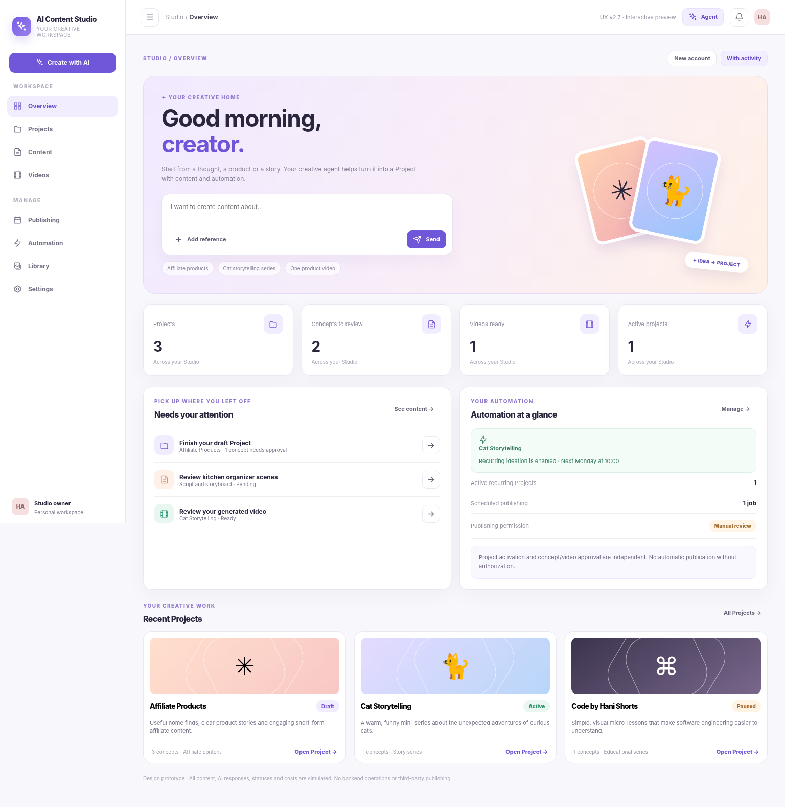
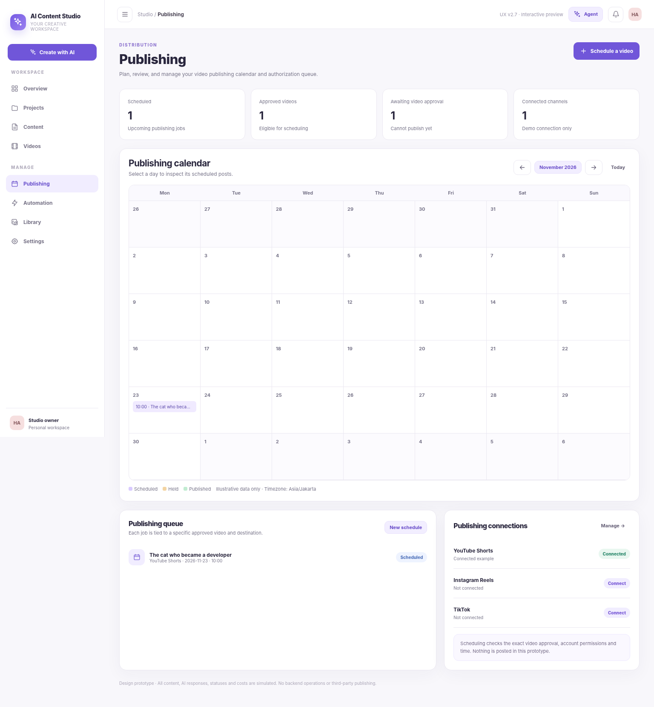
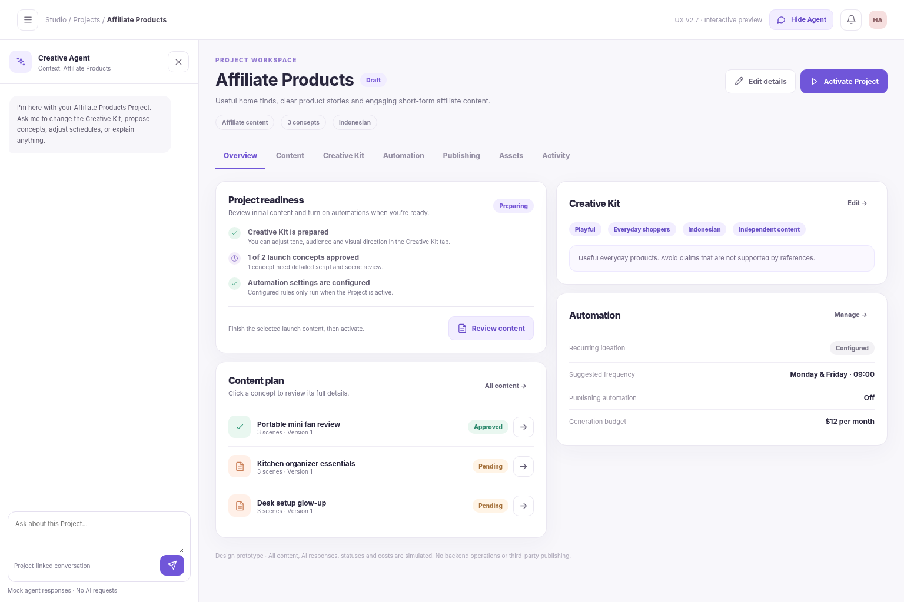
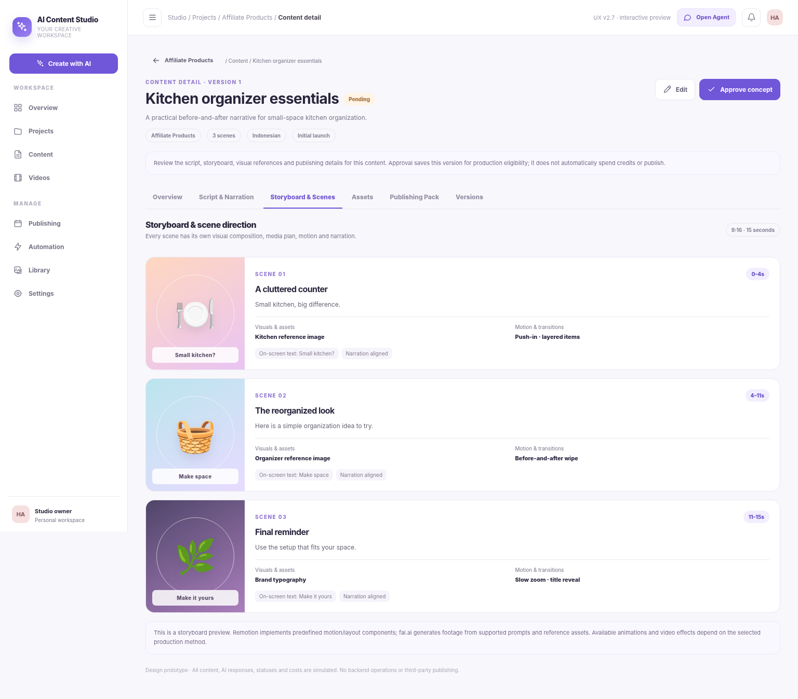
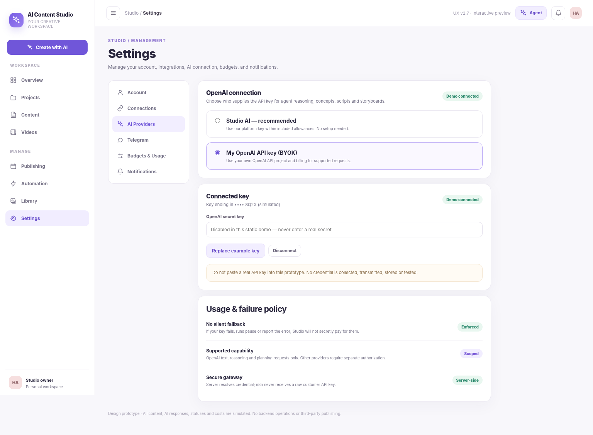

# AI Content Studio

**Your Idea. On-Brand Creativity. Automated Production.**

AI Content Studio is an agent-driven platform for planning, producing, reviewing, and scheduling short-form video content. A shared Creative AI Agent (web + Telegram) turns ideas into **Projects** with Creative Kits, concepts, storyboards, Remotion/fal/Hybrid production, and calendar-based publishing — with hard separation between activation, creative approval, paid generation, and destination publish.



## Problem

Creators and small teams juggle ideation, scripting, asset production, review, and multi-platform posting across disconnected tools. Automation that "just posts" is unsafe; tools that only draft text don't finish the video/publish loop. Teams need **orchestration with consent gates**, durable history, and honest provider status — not a single "generate" button that silently spends or publishes.

## Solution

A Project-centric studio where:

1. Conversation creates a **Draft Project** (no extra Generate confirm).
2. Humans approve **exact concept versions** and **exact video attempts**.
3. **Activation** enables selected automation only — it does **not** authorize paid renders or publishing.
4. **n8n** orchestrates agent, ideation, production, publish, and recovery.
5. **Next.js** owns auth, RLS, claims, spend grants, and the **AI Provider Gateway** (managed OpenAI + BYOK).

## Product pathway: P2 + P3

Aligned with PRD/TDD phasing:

| Phase | Focus | In this repo |
|---|---|---|
| **P2 — Creative video production** | Concepts, Creative Kit, Remotion/fal/Hybrid, review, BYOK | Core domain + UI **Verified** / video providers **Fixture** |
| **P3 — Automation & distribution** | Recurring ideation, Telegram, publishing, recovery, ops | APIs/UI/n8n JSON **Implemented**; live OAuth/Telegram **Blocked** on credentials |

Advanced creativity/teams (PRD Phase 4) is intentionally lean.

## Architecture

```text
Browser / Telegram
        │
        ▼
 Next.js App Router  ──►  Supabase (Auth, Postgres+RLS, Storage)
        │
        │  signed webhooks / outbox claims
        ▼
      n8n  ──HTTP──►  /api/internal/*  (claims, tools, AI gateway)
        │
        ▼
 AI Provider Gateway ──► OpenAI (managed env key OR encrypted BYOK)
 Remotion worker / fal.ai / ElevenLabs / social adapters (server-side)
```

**Important:** OpenAI is **not** configured as an n8n Chat Model credential. Workflows call `/api/internal/ai/check-policy` and `/api/internal/ai/execute`. See [docs/ARCHITECTURE.md](docs/ARCHITECTURE.md).

## Technologies

| Layer | Stack |
|---|---|
| App | Next.js App Router, React, TypeScript, Tailwind |
| Data / Auth | Supabase Auth, PostgreSQL, RLS, Storage |
| Orchestration | n8n (importable workflow JSON) |
| AI | OpenAI via Next.js gateway (managed + BYOK) |
| Video | Remotion worker, fal.ai, ElevenLabs (fixtures until keys) |
| Tooling | pnpm workspace, Zod, Vitest, Docker Compose |

## Features

- Auth → **Overview** home
- Collapsible nav + Agent (focus page / side panel pattern)
- Shared agent conversation → automatic **Draft Project**
- Projects: Draft / Active / Paused / Stopped (unified detail)
- Creative Kit, Content Detail (script / storyboard / versions / approve)
- Concept versioning + initial-launch selection + activation gates
- Video jobs with spend authorization (`produce_paid_media`)
- Publishing **calendar** + separate **schedule** form
- Settings: AI Providers (managed vs BYOK), budgets surface
- 11 versioned n8n workflows under [`n8n/workflows/`](n8n/workflows/)

## Implementation status (honest)

| Area | Status |
|---|---|
| Auth, Overview, Projects, Concepts, Activation gates | **Verified** locally |
| Agent → Draft Project via AI Provider Gateway | **Verified** with **fixture** AI (sync path) |
| BYOK store / verify / decrypt-on-execute | **Verified** (fixture); live OpenAI calls need a real key |
| AI Provider Gateway + no silent managed fallback | **Verified** (unit + smoke) |
| Video pipeline claim/complete/approve | **Verified** with **fixtures** |
| Remotion real encode | **Stub** — not production-ready |
| fal.ai / ElevenLabs live | **Fixture** until keys |
| Publishing OAuth (YouTube etc.) | **Blocked** on credentials |
| Telegram agent | **Blocked** on bot token; stubs present |
| n8n live E2E orchestration | JSON ready; full import/run **Partial** |
| Playwright E2E suite | **Not started** |

Do **not** treat fixtures or stubs as production-ready. Details: [docs/TRACEABILITY.md](docs/TRACEABILITY.md) · [docs/PROGRESS.md](docs/PROGRESS.md).

## Screenshots

| Screen | Preview |
|---|---|
| Overview |  |
| Publishing calendar |  |
| Unified Project |  |
| Content detail |  |
| AI Providers (BYOK) |  |

More: [docs/design/](docs/design/README.md). Interactive prototype: [docs/design/prototype/AI-Content-Studio-UX-v2.7-Hybrid-Prototype.html](docs/design/prototype/AI-Content-Studio-UX-v2.7-Hybrid-Prototype.html).

## n8n workflows

Import JSON from [`n8n/workflows/`](n8n/workflows/) (see [n8n/workflows/README.md](n8n/workflows/README.md)):

WF-A1 Web Agent · WF-A2 Telegram · WF-A3 Shared Agent · WF-01 Ideation · WF-02 Production · WF-03 Publishing · WF-04 Errors · WF-05 Research · WF-06 Notifications · WF-07 Analytics · WF-08 Reconciliation.

Specification: [docs/specifications/N8N_WORKFLOWS.md](docs/specifications/N8N_WORKFLOWS.md).

## Specs in this repo

| Document | Path |
|---|---|
| PRD v2.2 | [docs/specifications/PRD.md](docs/specifications/PRD.md) |
| TDD v2.2 | [docs/specifications/TDD.md](docs/specifications/TDD.md) |
| n8n Spec v1.1 | [docs/specifications/N8N_WORKFLOWS.md](docs/specifications/N8N_WORKFLOWS.md) |
| UX Spec v2.7 | [docs/specifications/UX_SPECIFICATION.md](docs/specifications/UX_SPECIFICATION.md) |

External Master Package (read-only reference, not required to run): `../AI-Content-Studio-Complete-Package-v2.7/`.

## Quick start

```bash
pnpm install
cp .env.example apps/web/.env.local
# Fill Supabase keys from: supabase status
supabase start --ignore-health-check -x logflare,vector
pnpm db:reset   # if needed
pnpm n8n:up     # docker-compose
pnpm dev        # http://localhost:3000
```

- Supabase Studio: http://127.0.0.1:54323
- n8n: http://localhost:5678

Full guide: [docs/LOCAL_DEV.md](docs/LOCAL_DEV.md) · Credentials: [docs/CREDENTIALS.md](docs/CREDENTIALS.md).

### OpenAI keys (current architecture)

| Mode | Configure in |
|---|---|
| Managed | `OPENAI_API_KEY` in `apps/web/.env.local` + `ACS_AI_FIXTURE_MODE=false` |
| BYOK | App **Settings → AI Providers** (encrypted at rest) |
| n8n | **Do not** add OpenAI credentials — only `ACS_INTERNAL_SERVICE_TOKEN` |

## Documentation map

| Doc | Purpose |
|---|---|
| [docs/ARCHITECTURE.md](docs/ARCHITECTURE.md) | Implemented architecture |
| [docs/TRACEABILITY.md](docs/TRACEABILITY.md) | Requirements ↔ status |
| [docs/PROGRESS.md](docs/PROGRESS.md) | Milestones / blockers |
| [docs/DECISIONS.md](docs/DECISIONS.md) | ADRs |
| [docs/design/README.md](docs/design/README.md) | Prototypes & screenshots |

## License

Private / coursework project unless otherwise stated.
