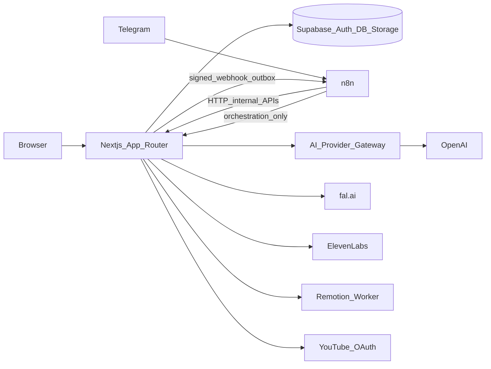
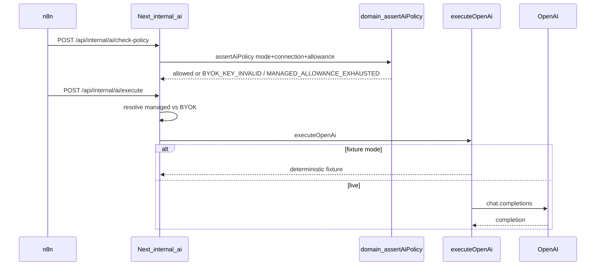

# Architecture — AI Content Studio

**Scope:** Architecture as **implemented** in this repository (plus intended n8n orchestration contracts).  
**Specs:** [PRD](specifications/PRD.md) · [TDD](specifications/TDD.md) · [n8n](specifications/N8N_WORKFLOWS.md)

## High-level topology



## Component responsibilities

| Component | Owns | Does not own |
|---|---|---|
| **`apps/web`** | UI, public APIs, internal APIs, session auth, AI gateway, claim/authorize gates | Long-running LLM loops as the only orchestration model |
| **`packages/domain`** | State transitions, activation/launch gates, grants, policy (BYOK no fallback) | Provider HTTP details |
| **`packages/schemas`** | Zod contracts / error codes | Persistence |
| **`packages/integrations`** | OpenAI/fal/ElevenLabs adapters + fixtures, secret encrypt/decrypt | Authorization decisions |
| **`packages/agent-contracts`** | Allowlisted tool names/schemas | Execution |
| **`apps/render-worker`** | Remotion job HTTP surface | **Verified:** currently fixture stub (`POST /render` → accepted) |
| **`n8n/workflows`** | Importable orchestration graphs | Provider secrets, business SoT |
| **`supabase/`** | Schema, RLS, storage policies | Application logic |

## Auth and tenancy

- Supabase Auth + `@supabase/ssr` cookie sessions.
- Public Route Handlers call `auth.getUser()`; RLS uses `owner_id = auth.uid()`.
- Internal APIs require `x-acs-service-token` (`ACS_INTERNAL_SERVICE_TOKEN`).
- Browser never receives service-role or BYOK plaintext.

## AI Provider Gateway (critical path)



**Invariant:** BYOK mode never uses `OPENAI_API_KEY` (studio-managed). Invalid/missing BYOK fails closed.

n8n workflows (**WF-A3**, **WF-01**, **WF-05**) call the gateway via `httpRequest` nodes — they do **not** use n8n OpenAI Chat Model credentials.

## Agent planning paths (current)

| Path | When | Status |
|---|---|---|
| Sync fixture in `POST /api/agent/messages` | `N8N_WEBHOOK_BASE_URL` unset | **Verified** (creates Draft Project via fixtures) |
| Webhook → n8n WF-A1 → WF-A3 → gateway | `N8N_WEBHOOK_BASE_URL` set | **Implemented in JSON + dispatch code; live E2E not fully verified** |

## Consent layers (enforced in domain)

1. Activate project ≠ concept approve ≠ video approve ≠ `produce_paid_media` ≠ publish destination.
2. First activation requires nonempty `selected_for_initial_launch` with approved, non-revoked working versions.
3. Video render requires `produce_paid_media` grant or returns `BUDGET_AUTHORIZATION_REQUIRED`.

## Data model (abbreviated)

Account → Projects → Concepts → Concept Versions → Video Jobs/Attempts → Publishing Jobs  
Plus: Creative Kit (`project_brand_kits`), conversations/messages, automation_rules, outbox/workflow_runs, AI provider prefs/connections/usage.

Full schema: [`supabase/migrations/`](../supabase/migrations/).

## Repository layout

```text
apps/web                 Next.js UI + APIs
apps/render-worker       Remotion worker (stub today)
packages/{domain,schemas,integrations,agent-contracts}
n8n/workflows            Importable workflow JSON
supabase/                Migrations + local config
docs/                    Specs, architecture, progress
```

## Trust boundaries

| Boundary | Mechanism |
|---|---|
| Browser ↔ API | Session cookies, no service role |
| n8n ↔ API | Shared service token + scoped internal routes |
| BYOK secrets | AES-GCM at rest (`ACS_CREDENTIAL_ENCRYPTION_KEY`); never in n8n env |
| Managed OpenAI | `OPENAI_API_KEY` on Next.js only |

## Related docs

- [LOCAL_DEV.md](LOCAL_DEV.md) — run locally  
- [CREDENTIALS.md](CREDENTIALS.md) — env vars  
- [TRACEABILITY.md](TRACEABILITY.md) — requirements ↔ status  
- [PROGRESS.md](PROGRESS.md) — milestone tracking  
