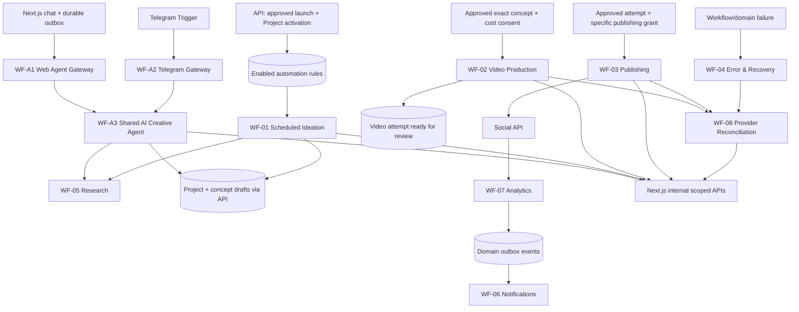

# AI Content Studio — n8n Workflow Design Specification

**Version:** 1.1 — includes managed OpenAI/BYOK provider routing  
**Based on:** `AI-Content-Studio-PRD-v2.1.md` and `AI-Content-Studio-TDD-v2.1.md` (both remain unchanged)  
**Scope:** All eleven logical n8n workflows (WF-A1/A2/A3 and WF-01…08)  
**Status:** Proposed node-level blueprint; **not deployed, tested with providers, or importable n8n workflow JSON**.

## 1. Decisions inherited from PRD/TDD v2.2

1. **n8n is the central orchestration engine** for one shared AI agent, scheduled ideation, video creation, publishing, research, notifications, analytics and recovery.
2. **Next.js domain APIs remain authoritative** for authentication, authorization, approvals, state transitions, consent, job claims and persistent business data. n8n has no unrestricted database service-role access.
3. A first *actionable* web/Telegram creative message automatically begins one durable draft Project-planning run. A greeting may instead produce `needs_input`. **No separate Generate/Accept Draft button.**
4. Project lifecycle is `draft`, `active`, `paused`, `stopped`, `archived`; Project is not itself an approved entity. One Project read/edit contract works in every status.
5. **First activation requires >=1 launch-selected concept whose current working version is approved and non-revoked.** Approval/launch selection/activation are separate operations. Resume does not reapply that first-launch gate.
6. Video render authorization is **separate from** concept approval and activation. Video approval is **separate from** publishing authorization. Publishing always targets an exact approved attempt and an authorized destination.
7. Per-Project timezones and due occurrences are calculated/stored in PostgreSQL via API, not by regenerating one n8n Cron/Schedule node per Project.
8. Human review is a **durable database state**: do not pause an n8n execution for days awaiting a user's approval.
9. Browser disconnected, workflow crashed or callback duplicated must not lose conversation, create another Project, double-charge a render or double-post a video.
10. Brand/Creative Kit options use versioned validation and preserve explicit user overrides; storyboards, concepts and outputs are immutable/version-pinned when approved.

## 2. How the workflows connect



**Key connection:** Agent proposals are not approvals. n8n nodes may *ask* Next.js to perform scoped actions; only domain services decide whether an action is allowed and commit it.

## 3. Workflow catalogue

| ID | Workflow | Trigger | End result | Phase |
|---|---|---|---|---|
| WF-A1 | Web Agent Gateway | Webhook POST from Next.js after the message + durable run/outbox record are committed. | 202 acceptance only after dispatch, durable agent messages/stages via API | 1 |
| WF-A2 | Telegram Agent Gateway | Telegram Trigger: private-message updates and callback queries (separate conditional branches). | Verified agent message record and concise Telegram bot reply/link | 3 |
| WF-A3 | Shared Creative Agent | Execute Sub-workflow Trigger from WF-A1, WF-A2 or another authorized agent call. | Persisted assistant response, ready draft sections and authorized domain operations | 1 |
| WF-01 | Scheduled Ideation | Schedule Trigger on short fixed dispatcher cadence | Persisted draft concepts and occurrence completion/next-due state | 3 |
| WF-02 | Video Production | Claimable video_jobs queued by approved exact concept version + production/cost authorization. | Persisted video attempt, private output asset and ready_for_review or blocked/failed status | 2 |
| WF-03 | Scheduled Publishing | Central due-claim scheduler for publishing jobs/slots, with outbox fast path. | Published provider post ID/URL or held/blocked/reconciling state | 3 |
| WF-04 | Error Handling and Recovery | Error Trigger for automatic n8n workflow failures plus explicit domain error outbox events. | Persisted error audit, bounded retry/reconciliation task and optional notification | 1 |
| WF-05 | Trend and Product Research | Execute Sub-workflow Trigger from WF-A3 or WF-01 | Evidence records with source timestamp, claims, confidence, caveats | 3 |
| WF-06 | Notifications | Event outbox/due notification claim, including draft-ready, review-needed, blocked, published, budgets. | Delivery attempt and receipt/error per channel | 3 |
| WF-07 | Platform Analytics | Scheduled authorized analytics refresh per connected destination/project. | Timestamped platform_metrics and insight_snapshots | 4 |
| WF-08 | Provider Reconciliation | Scheduled scan of reconciling jobs + provider verified callbacks received by Next.js. | Confirmed success/failure or still_unknown with next-check schedule | 2 |

**Phase references:** 1 = app/agent foundation; 2 = video production; 3 = automation & distribution; 4 = analytics/advanced. All workflows are specified now; implementation order still follows dependencies.

## 4. Shared architectural constraints

### 4.1 Shared job envelope (proposed)

- `runId` / `jobId`: trusted durable server-generated UUID; not model-generated.
- `correlationId`, `causationId`, `idempotencyKey`, `eventType`, `schemaVersion`.
- `projectId`, `conversationId`, `conceptId`, `conceptVersionId`, `attemptId`: optional by kind, always reverified server-side.
- `executionContext`: short-lived signed scope/nonce/expiry from API, **not** a browser-supplied owner ID.
- `leaseToken` / fencing version, `deadlineAt`, `retryCount`, `policySnapshotVersion`.
- `providerRequestId`: durable remote ID for reconciliation, never invent from timeout.

Treat n8n inputs as untrusted until API resolution; signed contexts can expire and must not be used to authorize late external side effects. Each critical external side effect needs a fresh API gate.

### 4.2 Standard reusable subflows / tool adapters

These are implementation helpers, **not additional top-level product workflows**:

- `SUB-ScopedDomainTool`: `Execute Sub-workflow Trigger` → validated scoped request → `HTTP Request POST /api/internal/agent/tool` → sanitised tool result. Make one named agent tool for each distinct allowed operation, not one arbitrary URL executor.
- `SUB-ProgressReporter`: stage validation → `POST /api/internal/agent/record-progress`; append sequential events with `runId` and event ID/cursor.
- `SUB-ProviderAdapter`: typed media/source/publishing adapter entry; Next.js/worker owns provider credentials and input validation.
- `SUB-JobEvent`: claim/progress/complete/fail helpers with correlation, lease token, idempotency key, and bounded retry semantics.
- `SUB-CreativeValidator`: send AI-produced strict structured outputs to Zod/domain service; report explicit validation errors; repair only within bounded attempts.

For n8n AI Agent, connect a **tested gateway-backed model transport**, if the pinned installed n8n version supports it, and named `Call n8n Workflow Tool` sub-nodes. The tool's input-item semantics differ from ordinary nodes. If the gateway-backed model transport cannot support the required tool loop, orchestrate the model/tool calls explicitly in n8n using `HTTP Request` to the backend AI gateway and the same scoped subworkflow tools; do **not** use a shared static OpenAI credential for user BYOK requests.

### 4.3 Dispatch strategy and durable state

- Next.js writes message/job/outbox **before** handing work to n8n. Outbox delivery may be retried until acknowledged.
- A1 uses a private signed webhook and acknowledges quickly after dispatching A3; browser uses persistent run/event APIs to display real progress.
- WF-01/03/06/07/08 use fixed n8n `Schedule Trigger` dispatchers that call protected **atomic claim-due** domain APIs. These are timer ticks, not where Project schedules are stored.
- Run/concept/video/publishing status is stored in Supabase through API. n8n execution history is operational evidence, **not** the source of truth.
- A callback to an external service should land in a verified **Next.js callback endpoint**, with the backend validating signatures/dedupe before n8n claims follow-up work.
- n8n `Wait` may be used for short bounded provider delays if advantageous, but **never** as the sole durable approval queue or as a substitute for the application's persisted job state.

### 4.4 Essential guards before external effects

| Action | Final authoritative check |
|---|---|
| Save draft Project | Same planning `runId`, correct unlinked conversation or explicit authorized context, one Project per initiating run |
| Change Creative Kit or concept | Project scope, expected working version, facts/restrictions, explicit user/approved agent tool permission |
| Activate Project | Draft, launch-selected nonempty, working version == latest nonrevoked approved, rules and acknowledgments valid |
| Start paid generation | Exact approved concept version, Project/manual policy, provider compatibility, budget/spend grant, fresh reservation |
| Approve video | Actual completed validated attempt ID and reviewer permission |
| Publish | Project/rule status, exact video attempt approved, account scopes, metadata snapshot, destination grant, due time/series order |
| Retry external side effect | Proven safe remote state or provider idempotency key; otherwise reconcile before retry |

### 4.5 Error and observability conventions

- Standard outcome codes: `ok`, `skipped`, `held`, `needs_input`, `blocked`, `reconciling`, `failed`; error categories `VALIDATION`, `AUTHZ`, `COST`, `RATE_LIMIT`, `NETWORK_TRANSIENT`, `PROVIDER_UNKNOWN`, `PROVIDER_FAILED`, `ASSET_QA`, `OAUTH`, `POLICY_CHANGED`.
- Every job emits `runId/jobId`, `correlationId`, `step`, `attempt`, `providerRequestId` (if any), elapsed duration, estimated/actual cost where available, and sanitized reason.
- Treat an unknown remote outcome as `reconciling`; never retry a possible successful charge/upload blindly.
- Keep large media in private object storage; n8n carries IDs/signed short-lived references, not multi-GB binary buffers.

## 5. Node-level workflow designs

Each workflow section below is generated from its detailed per-workflow design. The **nodes are a build blueprint, not an exported n8n JSON graph**; branch wiring and credentials must be implemented and tested inside the target n8n version.

### WF-A1 — Web Agent Gateway

**Receive a trusted dispatch of a web chat planning/message run and launch the shared agent without waiting for model completion.**

| Node | Type | Key configuration |
|---|---|---|
| A1-01 Receive dispatch | Webhook | POST production webhook; require internal header signature; respond using Respond to Webhook |
| A1-02 Normalize envelope | Edit Fields (Set) | Pick runId/conversationId/messageId/correlationId; drop unneeded fields |
| A1-03 Resolve signed context | HTTP Request | POST /api/internal/agent/resolve-context (trusted credential) |
| A1-04 Claim execution | HTTP Request | POST /api/internal/jobs/claim using jobId=runId, kind=agent_run; idempotent |
| A1-05 Eligible? | If | Test API claim=acquired and scope permits work |
| A1-06 Record rejected ingress | HTTP Request | POST /api/internal/workflows/record-error with sanitized reason |
| A1-07 Acknowledge duplicate/skipped | Respond to Webhook | Return 202 with runId and state; duplicate is safe |
| A1-08 Launch shared creative agent | Execute Sub-workflow | WF-A3; Wait for Sub-Workflow Completion OFF; one input item |
| A1-09 Ack accepted | Respond to Webhook | 202 JSON {runId,accepted:true}; no generated plan in response |

**Key safeguards:** The first actionable message was already persisted by Next.js. A1 does not create the user message or determine whether intent is actionable. Duplicate dispatches claim the same run and never create two draft Projects.

**Detailed file:** [`workflows/WF-A1.md`](workflows/WF-A1.md)

### WF-A2 — Telegram Agent Gateway

**Use one Telegram bot as an alternate interface to the same agent and Project state; safely resolve identity and ingest media.**

| Node | Type | Key configuration |
|---|---|---|
| A2-01 Telegram updates | Telegram Trigger | Updates: Message and Callback Query as supported; private-chat policy |
| A2-02 Normalize update | Edit Fields (Set) | Extract updateId/chatId/userId/messageId/text/fileRefs/command |
| A2-03 Resolve Studio actor | HTTP Request | POST /api/internal/telegram/resolve-actor |
| A2-04 Link instructions | Telegram | Send Message with short-lived account-link instruction (no token in reply) |
| A2-05 Unsupported update | If | Filter unsupported chats/media/commands without side effects |
| A2-06 Intake attachment metadata | If | If referenced photos/voice/document exist, branch to A2-07 |
| A2-07 Fetch file | Telegram | Get File; enforce size, MIME, media constraints |
| A2-08 Upload via scoped service | HTTP Request | Protected asset-intake endpoint (to be specified) with validated metadata/stream |
| A2-09 Persist/dedupe message | HTTP Request | Application service message-inbox endpoint: transport-deduped creation; create planning run if actionable and unlinked |
| A2-10 Claim & route | HTTP Request | Claim run/resolve signed conversation context (same permissions as web) |
| A2-11 Invoke shared agent | Execute Sub-workflow | WF-A3; Wait for Sub-Workflow Completion OFF; send final reply later via WF-06 |
| A2-12 Send initial acknowledgement | Telegram | Send brief accepted/planning message and secure web deep link; do not wait for model |
| A2-13 Record delivery/run state | HTTP Request | Persist delivery ID and correlation; safeguard failure paths |

**Key safeguards:** Telegram chat numeric ID alone is not an authenticated Studio account; actor must be linked through a verified challenge. Telegram and web share one Project/conversation authorization model and tool allowlist.

**Detailed file:** [`workflows/WF-A2.md`](workflows/WF-A2.md)

### WF-A3 — Shared Creative Agent

**Interpret creative intentions, orchestrate scoped research and structured generation, and save draft/project/concept changes through the API.**

| Node | Type | Key configuration |
|---|---|---|
| A3-01 Start with typed input | Execute Sub-workflow Trigger | Define input fields; single conversational request per execution |
| A3-02 Load scope & context | HTTP Request | POST /api/internal/agent/resolve-context; authorized Project, history, kit and permission flags |
| A3-03 Intent branch | Switch | New creative intent / modify Project / modify concept / clarify / status query |
| A3-04 Record interpreting | HTTP Request | POST /api/internal/agent/record-progress stage=interpreting |
| A3-05 Creative reasoning | AI Agent | Gateway-backed model adapter (tested) + scoped tools, else explicit n8n HTTP Request/model-tool loop |
| A3-06 Tool: read Project | Call n8n Workflow Tool | get_project_context -> restricted internal tool adapter |
| A3-07 Tool: research | Call n8n Workflow Tool | research_products/research_trends -> WF-05 or approved evidence adapters |
| A3-08 Tool: plan/draft | Call n8n Workflow Tool | propose_project/propose_concepts/propose_visual_plan; bounded structured output |
| A3-09 Tool: authorized edits | Call n8n Workflow Tool | create_draft_project/save_concept_drafts/revise_concept via POST /api/internal/agent/tool |
| A3-10 Validate generation | HTTP Request | Strict Zod/domain service validation incl product claims, storyboard, kit options |
| A3-11 Record stages/sections | HTTP Request | POST /api/internal/agent/record-progress for researching/creative_direction/concepts/configuration/finalizing |
| A3-12 Commit draft/link | HTTP Request | POST /api/internal/agent/tool create_draft_project keyed by runId; transactional conversation Project link |
| A3-13 Record final agent reply | HTTP Request | POST /api/internal/agent/record-result with citations, actions, status |
| A3-14 Return compact reply | Edit Fields (Set) | Reply text, projectId, runId, needsInput, source labels |

**Key safeguards:** AI Agent tools attach as sub-nodes; tool calls must use authorized service adapters, not arbitrary account-wide Supabase roles. For first message, input provides authorization for draft proposal/creation only; no paid provider calls, activation or publication.

**Detailed file:** [`workflows/WF-A3.md`](workflows/WF-A3.md)

### WF-01 — Scheduled Ideation

**Create new draft concepts for active Projects according to saved recurring rules and evidence policy.**

| Node | Type | Key configuration |
|---|---|---|
| 01-01 Poll scheduler | Schedule Trigger | Fixed every N minutes; NOT one node per Project timezone |
| 01-02 Claim due work | HTTP Request | POST /api/internal/automation/claim-due kind=ideation |
| 01-03 Loop occurrences | Loop Over Items (Split in Batches) | Bound batch size/concurrency by service policy |
| 01-04 Revalidate policy | HTTP Request | Fetch Project active, rule enabled, no revoked consent; brand snapshot |
| 01-05 Load recent backlog | HTTP Request | Scoped read of concepts, series continuity, schedule, prompt restrictions |
| 01-06 Strategy branch | Switch | original / trend / hybrid |
| 01-07 Optional trend research | Execute Sub-workflow | WF-05, wait ON for bounded research result |
| 01-08 Generate concepts | AI Agent | Structured ideation via backend AI gateway + scoped read tools; no per-owner OpenAI key in n8n |
| 01-09 Validate/dedupe | HTTP Request | Strict schema, source evidence and semantic duplicate safeguards in API |
| 01-10 Save drafts | HTTP Request | POST /api/internal/agent/tool save_concept_drafts with occurrenceId as idempotency key |
| 01-11 Complete occurrence | HTTP Request | POST /api/internal/jobs/complete including next due and cost metadata |
| 01-12 Next occurrence | Loop Over Items (Split in Batches) | Continue until batch done |

**Key safeguards:** Use one central due-claim scheduler and Postgres occurrence uniqueness; not dynamically editable Cron nodes for each Project. New concepts default to draft/pending review, never silently activate rendering or publishing.

**Detailed file:** [`workflows/WF-01.md`](workflows/WF-01.md)

### WF-02 — Video Production

**Orchestrate asset preparation, voice, Remotion/fal.ai/Hybrid generation, QA and version-pinned outputs.**

| Node | Type | Key configuration |
|---|---|---|
| 02-01 Receive production intent | Webhook | Protected outbox dispatch; periodic re-driver possible |
| 02-02 Claim job | HTTP Request | POST /api/internal/jobs/claim kind=video with lease/fencing token |
| 02-03 Final entitlement check | HTTP Request | Validate exact approved version, Project state/manual grant, remaining spend/reservation |
| 02-04 Load locked input | HTTP Request | Read immutable Visual Plan, rights, owned assets, provider capability catalog |
| 02-05 Validate scene contract | HTTP Request | Zod/domain plan check: aspect/duration/safe areas/models and scene sources |
| 02-06 Prepare references | HTTP Request | Invoke controlled asset preparation adapter + private storage; no untrusted external URLs |
| 02-07 Narration required? | If | Check storyboard voice and subtitle requirements |
| 02-08 Generate/align voice | HTTP Request | TTS adapter (ElevenLabs), measured durations; expense gate before call |
| 02-09 Mode switch | Switch | remotion / fal / hybrid |
| 02-10 Remotion adapter | HTTP Request | Start dedicated renderer job and store request ID |
| 02-11 fal.ai adapter | HTTP Request | Submit allowed model async, record provider request ID before waiting |
| 02-12 Hybrid adapter | HTTP Request | Create fal footage + Remotion composition as separate tracked stages |
| 02-13 Persist provider state | HTTP Request | POST /api/internal/jobs/progress with provider ID, stage and costs |
| 02-14 Collect output | HTTP Request | Provider callback/status or authorized server-poll adapter; bounded processing |
| 02-15 Media QA | HTTP Request | Video validation worker: dimensions, playback, audio, captions, file checksum, accessibility |
| 02-16 Complete output | HTTP Request | POST /api/internal/jobs/complete with private assetId and attempt version lineage |
| 02-17 Block/fail or reconcile | HTTP Request | POST /api/internal/jobs/fail with reason, clear consent status, reconciling if unknown |

**Key safeguards:** Paid generation cannot start without exact grant or preapproved budget policy and reservation; recheck immediately before side effect. All approved inputs/outputs are immutable version-pinned; regenerate creates independent attempt; changing substantive content requires a new approved concept version.

**Detailed file:** [`workflows/WF-02.md`](workflows/WF-02.md)

### WF-03 — Scheduled Publishing

**Release one exact approved video attempt to one connected authorized destination at its allowed time.**

| Node | Type | Key configuration |
|---|---|---|
| 03-01 Tick/dispatch | Schedule Trigger | Fixed due-job dispatcher; outbox can accelerate queued tasks |
| 03-02 Claim due publish | HTTP Request | POST /api/internal/automation/claim-due kind=publishing_jobs |
| 03-03 Loop due jobs | Loop Over Items (Split in Batches) | Small batch and platform-specific rate limits |
| 03-04 Final authorization | HTTP Request | POST /api/internal/publish/authorize-claim |
| 03-05 Allowed? | If | If held/blocked -> write reason and continue |
| 03-06 Validate publishing pack | HTTP Request | Destination adapter: metadata/visibility/rights/episode order/asset ready |
| 03-07 Prepare platform payload | Edit Fields (Set) | Use snapshotted metadata and destination ID; never fetch latest revision |
| 03-08 Begin attempt record | HTTP Request | Create provider_upload_attempt + correlation and idempotency token before upload |
| 03-09 Platform switch | Switch | YouTube / future allowed APIs; per-destination adapter |
| 03-10 Upload/publish | HTTP Request | Call server publishing adapter, not direct browser token |
| 03-11 Did provider confirm? | Switch | Confirmed / explicit rejection / uncertain |
| 03-12 Record confirmed publication | HTTP Request | POST /api/internal/jobs/complete with provider postId and URL |
| 03-13 Record reconciling | HTTP Request | Mark uncertain with remote operation ID; enqueue WF-08; do not reupload |
| 03-14 Continue | Loop Over Items (Split in Batches) | Next due job |

**Key safeguards:** One job per exact video output + destination; multi-platform publication generates separate jobs. An authorized due slot with no approved video holds/skips; it does not generate media or approve concepts.

**Detailed file:** [`workflows/WF-03.md`](workflows/WF-03.md)

### WF-04 — Error Handling and Recovery

**Classify n8n and domain errors, make bounded safe retry decisions and expose actionable diagnostics.**

| Node | Type | Key configuration |
|---|---|---|
| 04-01 Automatic failure | Error Trigger | Configured as error workflow on all applicable workflows |
| 04-02 Normalize error | Edit Fields (Set) | Extract origin/exec/correlation; remove payload secrets |
| 04-03 Record incident | HTTP Request | POST /api/internal/workflows/record-error |
| 04-04 Classify | Switch | Validation / permission / spend / rate-limit / transient / remote-unknown / platform etc |
| 04-05 Retry eligible? | If | Only bounded idempotent operations with durable job/lease |
| 04-06 Schedule retry | HTTP Request | Server places delayed retry in outbox/lease queue, not uncontrolled self-recursion |
| 04-07 Notify/hold | HTTP Request | Mark terminal or needs_input; emit notification event |
| 04-08 Reconciliation intent | HTTP Request | Enqueue WF-08 for ambiguous remote call |
| 04-09 Finish | Edit Fields (Set) | Return recorded severity/result |

**Key safeguards:** n8n Error Trigger only runs for eligible automatic executions; explicit failure branches must call domain error reporting. Never log raw credentials, private transcript body, or social OAuth tokens.

**Detailed file:** [`workflows/WF-04.md`](workflows/WF-04.md)

### WF-05 — Trend and Product Research

**Collect dated, rights-aware evidence for requested products/trends and return grounded citations to creative tasks.**

| Node | Type | Key configuration |
|---|---|---|
| 05-01 Typed research request | Execute Sub-workflow Trigger | Input query scope, Project/actor context and freshness rules |
| 05-02 Scope/policy check | HTTP Request | Confirm Project owner, allowlisted providers, query budget, source terms |
| 05-03 Build search queries | AI Agent | Constrained query expansion with read-only tools; no claims invented |
| 05-04 Provider/search branch | Switch | Product facts / public trend signals / permitted structured feeds |
| 05-05 Fetch sources | HTTP Request | Official/authorized research provider API; rate limit and timeouts |
| 05-06 Normalize claims | Edit Fields (Set) | Name fact source, observed time, market/region, price limitations |
| 05-07 Rank and dedupe | Code | Small deterministic relevance/freshness scoring (not user supplied code) |
| 05-08 Validate provenance | HTTP Request | Validate sources, prohibited claims, product references through domain schema |
| 05-09 Persist evidence | HTTP Request | Save source_evidence/trend_signals with source ids and expiry |
| 05-10 Return research bundle | Edit Fields (Set) | Sources+claimIds+timestamps+warnings and original-only fallback flag |

**Key safeguards:** Never represent general creative suggestions as verified trends; no fabricated prices, availability, manufacturer specifications. Check licensing/robots/terms of source providers; avoid unauthorized scraper design.

**Detailed file:** [`workflows/WF-05.md`](workflows/WF-05.md)

### WF-06 — Notifications

**Deliver consented in-app/Telegram/email updates without changing business state.**

| Node | Type | Key configuration |
|---|---|---|
| 06-01 Poll notification work | Schedule Trigger | Short polling/dispatch or trusted outbox event |
| 06-02 Claim notifications | HTTP Request | Claim due notifications from domain API; namespaced service scope |
| 06-03 Load preferences | HTTP Request | Get user quiet hours, timezone, Telegram link/email consent |
| 06-04 Delivery allowed? | If | Check preference, quiet time, unlink, account status |
| 06-05 Template message | Edit Fields (Set) | Locale-safe concise text and deep links; no secrets |
| 06-06 Channel switch | Switch | In-app / Telegram / email |
| 06-07 Telegram send | Telegram | Send Message with verified linked chat ID |
| 06-08 Email send | Send Email | SMTP/approved email provider transport; configured credentials |
| 06-09 Mark result | HTTP Request | Persist channel delivery status, receipt and failure metadata |
| 06-10 Next item | Loop Over Items (Split in Batches) | Continue eligible deliveries |

**Key safeguards:** Notifications do not approve, activate or publish anything. Obey preference, quiet hours and link revocation at send time.

**Detailed file:** [`workflows/WF-06.md`](workflows/WF-06.md)

### WF-07 — Platform Analytics

**Collect authorized platform statistics and propose insights without automatically changing creative permissions.**

| Node | Type | Key configuration |
|---|---|---|
| 07-01 Analytics scheduler | Schedule Trigger | Fixed dispatcher cadence |
| 07-02 Claim refresh | HTTP Request | Claim eligible analytics job and rate-limit allowance |
| 07-03 Check OAuth and scopes | HTTP Request | Verify analytics grants for exact account/platform |
| 07-04 Fetch platform metrics | HTTP Request | Provider analytics adapter; cursor/page and bounded backoff |
| 07-05 Normalize | Edit Fields (Set) | Views, engagement, watch metrics where actually supplied; source timestamp |
| 07-06 Store snapshot | HTTP Request | Upsert idempotent platform_metrics with collection time |
| 07-07 Optional insight synthesis | AI Agent | Read-only analysis of normalized authorized metrics |
| 07-08 Validate and save insight | HTTP Request | Persist contextual insight and limitations |
| 07-09 Complete refresh | HTTP Request | Record cursor, quota and next due |

**Key safeguards:** Metrics are provider-specific and may be delayed, sampled or incomplete. An AI insight is not proof of causal lift or authorization to change schedules.

**Detailed file:** [`workflows/WF-07.md`](workflows/WF-07.md)

### WF-08 — Provider Reconciliation

**Resolve externally ambiguous production and publishing outcomes without duplicate charges or posts.**

| Node | Type | Key configuration |
|---|---|---|
| 08-01 Reconciliation scheduler | Schedule Trigger | Periodic scan plus callback-triggered outbox fast path |
| 08-02 Claim uncertain jobs | HTTP Request | Claim reconciling jobs; recover expired leases only after checks |
| 08-03 Load remote identifiers | HTTP Request | Fetch exact provider + request id, object lineage, latest callback |
| 08-04 Type switch | Switch | fal/video / Remotion worker / social upload / external asset |
| 08-05 Poll verified status | HTTP Request | Read-only provider adapter status or signed callback evidence |
| 08-06 Outcome switch | Switch | succeeded / failed / still_running / unknown |
| 08-07 Confirm success | HTTP Request | Validate output/post evidence, perform idempotent job completion |
| 08-08 Confirm failure | HTTP Request | Record provider rejection/cancellation, settled cost |
| 08-09 Schedule next check | HTTP Request | Backoff with bounded TTL and escalation reason |
| 08-10 Emit status notice | HTTP Request | Outbox event for change/attention required |

**Key safeguards:** Provider callbacks must be authenticated by Next.js and associated with the exact known attempt before entering the reconciliation queue. No second paid submit or social upload is issued by WF-08.

**Detailed file:** [`workflows/WF-08.md`](workflows/WF-08.md)


## 6. Cross-workflow event contracts and examples

`contracts/` contains illustrative JSON payloads for A1 dispatch, planning progress, concept approval-derived render intent, publishing claim and provider reconciliation. These are **proposed example shapes** and must become validated OpenAPI/Zod schemas before implementation.

### Domain event names (proposed)

`agent.message.received`, `agent.planning.started`, `agent.planning.progress`, `project.draft.created`, `concept.version.approved`, `project.activated`, `video.render.authorized`, `video.attempt.ready_for_review`, `video.attempt.approved`, `publishing.job.scheduled`, `publishing.job.published`, `publishing.job.unknown`, `automation.occurrence.due`, `provider.callback.verified`, `notification.due`.

Event delivery is **at least once**. Consumers must be idempotent. These are proposed logical event names, not proof that existing database migrations already implement them.

## 7. Cross-workflow acceptance test matrix

| Test | Expected observation | Primary workflows |
|---|---|---|
| User sends first idea | One planning run, actual progress, one Draft Project, no second Generate action | A1, A3 |
| User writes only “hi” | Clarification/ordinary reply, no incorrect Draft Project | A1, A3 |
| Duplicate first-message dispatch | Same Project ID, no repeated billing/research charge | A1, A3 |
| Linked Telegram creates Project | Same server scope/history as web; one Draft Project, no duplicate on replay | A2, A3 |
| User edits scene after approving it | New version requires approval; older published attempt unchanged | A3, WF-02, WF-03 |
| Activation with unapproved selected launch item | Transaction fails; no automatic rules enabled | API gate before WF-01/02/03 |
| Active Project gets scheduled ideation | One draft batch at due occurrence; not automatically published | WF-01, WF-05 |
| Paid render not authorized | Blocked before provider call, with consent reason | WF-02 |
| Provider times out after charge | Unknown/reconciling, lookup remote requestId, no second submit | WF-02, WF-08 |
| Video approved but no publishing grant | Never upload automatically | WF-03 |
| Pause Project just before publish | Atomic authorization gate holds job | WF-03 |
| Upload returns unknown status | Reconciling; no blind re-upload; exact post ID before published | WF-03, WF-08 |
| OAuth expired | Held/reconnect notice; no attempt to reuse revoked token | WF-03, WF-06 |
| Error workflow fails | Escalation/monitoring catches unreported incident | WF-04 |
| Quiet hours and unsubscribe | Delivery suppressed/deferred; original job unaffected | WF-06 |
| Analytics grants revoked | No new account data fetched | WF-07 |

## 7.1 API and adapter gaps surfaced by node-level design

These are implementation contract **proposals**, not claims that the v2.1 TDD already implements these endpoints. For exact TDD v2.1 routes, see §6.1 and §21 of that document.

| Need discovered | Existing v2.1 TDD support | Contract to finalize before building |
|---|---|---|
| Web first-message dispatch | `POST /api/agent/messages`, signed n8n invocation, run/outbox, `record-progress`, `resolve-context` | Private webhook signature, job-claim payload, ack/re-drive policy |
| Telegram inbound message intake | `/api/internal/telegram/resolve-actor`, Telegram link and generic agent message contract | Add a scoped **Telegram message intake + attachment-upload** internal operation (path TBD); server persists/dedupes messages and starts planning if needed |
| Agent reply delivery on Telegram | `record-result`, `agent_messages`, notifications | Emit `agent.reply.ready` outbox event and define safe Telegram send payload/ack rules |
| Generic agent tool subflows | `POST /api/internal/agent/tool` and named tool list | Per-tool typed input/output schemas, tool permissions, error envelopes |
| Scheduled due claims | `POST /api/internal/automation/claim-due` and job claim | Enumerate `kind` variants for ideation, publishing, notification, analytics and reconciliation; ensure leasing semantics |
| Media/provider adapters | Video job/attempt APIs, callbacks and protected job transitions | Server adapter routes (path TBD) and exact provider submit/status/cancel contracts for Remotion/fal/TTS |
| Research provider intake | `source_evidence`, `trend_signals` and agent tool contract | Select licensed data providers, strict source claim schema, storage operation |
| Delivery receipts and analytics | `notifications`, `platform_metrics`, `insight_snapshots` concepts | Typed notification-delivery claim/result and analytics-refresh claim/result operations (paths TBD) |

**Not a product change:** None of these adds a new approval step, Project lifecycle state, sidebar rule, or UI-specific wizard table. They are technical interfaces needed to implement the already-agreed workflows. The most important gap is Telegram ingress deduplication and the provider-specific adapter APIs.

## 8. Review checklist and decisions still to lock

These are **design choices**, not reasons to restart the PRD/TDD:

1. Choose **n8n Cloud vs self-hosted**; set actual concurrency, retention, database, queue-mode and webhook egress restrictions.
2. Decide initial **publishing destination** (YouTube recommended from TDD) and actual OAuth scopes/verified provider capabilities.
3. Choose exact **trend/product evidence providers** and legal acquisition method. No placeholder research node can guarantee live trends.
4. Verify **fal.ai model registry**, supported image/video inputs, polling/webhook paths, charge behavior and estimated cost at integration time.
5. Choose Remotion worker deployment and **TTS provider/voice defaults**, including audio alignment implementation.
6. Decide whether Telegram first release handles text only or also photo/voice intake, and set maximum media sizes.
7. Define currency, per-Project budgets, provider retry ceilings, and quality thresholds with real price data.
8. Lock JSON schemas/OpenAPI, event names, audit/retention and exact domain adapter endpoints before building workflow JSON.
9. Set test credentials, mock provider fixtures, and a staging workflow environment. Never use production secrets in fixtures.

## 9. n8n technical reference links

- [AI Agent](https://docs.n8n.io/integrations/builtin/cluster-nodes/root-nodes/n8n-nodes-langchain.agent/)
- [Call n8n Workflow Tool](https://docs.n8n.io/integrations/builtin/cluster-nodes/sub-nodes/n8n-nodes-langchain.toolworkflow/)
- [Execute Sub-workflow](https://docs.n8n.io/integrations/builtin/core-nodes/n8n-nodes-base.executeworkflow/)
- [Execute Sub-workflow Trigger](https://docs.n8n.io/integrations/builtin/core-nodes/n8n-nodes-base.executeworkflowtrigger/)
- [Schedule Trigger](https://docs.n8n.io/integrations/builtin/core-nodes/n8n-nodes-base.scheduletrigger/)
- [Webhook and Respond to Webhook](https://docs.n8n.io/integrations/builtin/core-nodes/n8n-nodes-base.webhook/)
- [Error Trigger](https://docs.n8n.io/integrations/builtin/core-nodes/n8n-nodes-base.errortrigger/)
- [Wait](https://docs.n8n.io/integrations/builtin/core-nodes/n8n-nodes-base.wait/)
- [Telegram Trigger](https://docs.n8n.io/integrations/builtin/trigger-nodes/n8n-nodes-base.telegramtrigger/)
- [Queue mode](https://docs.n8n.io/hosting/scaling/queue-mode/)

These links document available n8n nodes; they do not independently certify our future provider API payloads. Revalidate node versions when generating importable workflows.


## 10. v1.1 managed OpenAI / BYOK routing (cross-workflow update)

The user-selectable OpenAI provider mode is resolved **for every LLM request** through the trusted Next.js AI Provider Gateway. n8n does not hold customer OpenAI secret material or dynamically create customer n8n credentials. `managed` uses Studio's provider account subject to atomically enforced allowances; `byok` uses the owner's encrypted server-side credential. Every gateway call carries a signed actor/job scope, operation type, requested schema/model and correlation id; **never** a raw key.

**Node-level additions/replacements:**

| Workflow | Location | Updated behavior |
|---|---|---|
| WF-A1 Web Gateway | Dispatch | Preserve signed run scope and owner; no provider key in webhook body |
| WF-A2 Telegram Gateway | Actor resolution | Use verified linked owner; no Telegram-supplied provider identifiers can override owner preferences |
| WF-A3 Shared Creative Agent | Before A3-05 | HTTP Request `/api/internal/ai/check-policy` for selected mode, quota and allowed models; block/notify on invalid mode before reasoning |
| WF-A3 Shared Creative Agent | A3-05 reasoning | Tested gateway-backed model adapter **or** bounded HTTP Request / tool-call orchestrator in n8n; pass no customer credential to workflow data |
| WF-01 Scheduled Ideation | Before 01-08 | Same provider policy check; hold occurrence for disconnected/exhausted BYOK; preserve idempotency |
| WF-01 Scheduled Ideation | 01-08 generation | Call `/api/internal/ai/execute` through trusted n8n orchestration; record usage and owner/project correlation |
| WF-04 Error/Recovery | Provider errors | Normalize invalid-key/quota/rate-limit/unknown outcomes; do not reroute to Studio key |
| WF-06 Notifications | Blocked execution | Alert on invalid BYOK, exhausted managed allowance and necessary user intervention |
| WF-08 Reconciliation | Ambiguous OpenAI call | Reconcile provider request/usage when possible; avoid blind repeat of billable requests |

**Call envelope (safe, nonsecret):**

```json
{
  "runId": "run_illustrative",
  "ownerContextToken": "signed-short-lived-context-not-a-user-api-key",
  "operation": "draft_concepts",
  "projectId": "project_illustrative",
  "requestedModel": "configured-approved-model",
  "inputRef": "stored-prompt-or-template-ref",
  "responseSchema": "concept_batch_v2",
  "idempotencyKey": "ideation_occurrence_illustrative"
}
```

**Response:** validated structured creative data, provider request/correlation ID, safe model metadata, observed token usage and policy status. Errors include `BYOK_KEY_INVALID`, `BYOK_QUOTA_EXCEEDED`, `BYOK_MODEL_UNAVAILABLE`, `MANAGED_ALLOWANCE_EXHAUSTED`, `AI_PROVIDER_RATE_LIMITED`, and `PROVIDER_OUTCOME_UNKNOWN`. Exact API routes and loop behavior must be verified during implementation.

**Critical tests:** managed default works without a user key; BYOK is charged only through user's selected key; invalid BYOK never falls back to managed; Telegram and web share the preference; one user's workflow cannot select another user's key; n8n execution/error histories never include key plaintext; scheduled runs hold cleanly when the owner disconnects BYOK.

**Reference:** TDD v2.2 §23. The eleven-workflow architecture is retained; the secure AI gateway is a backend adapter, **not** a twelfth workflow.
