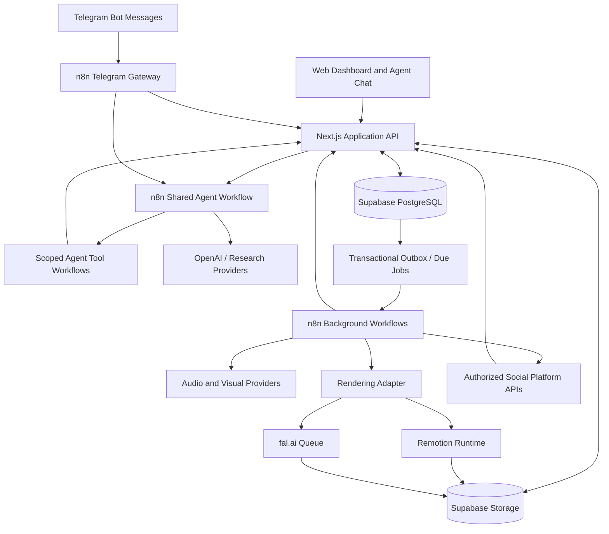
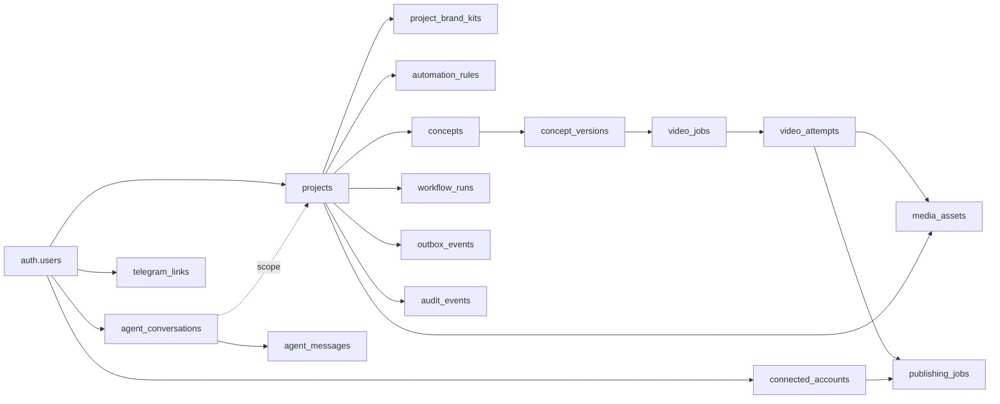
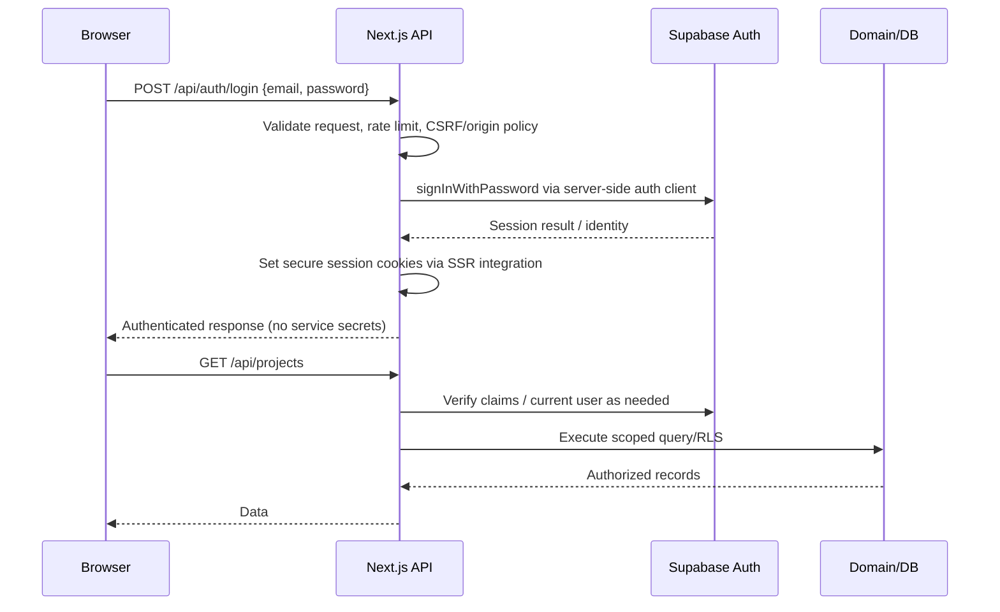
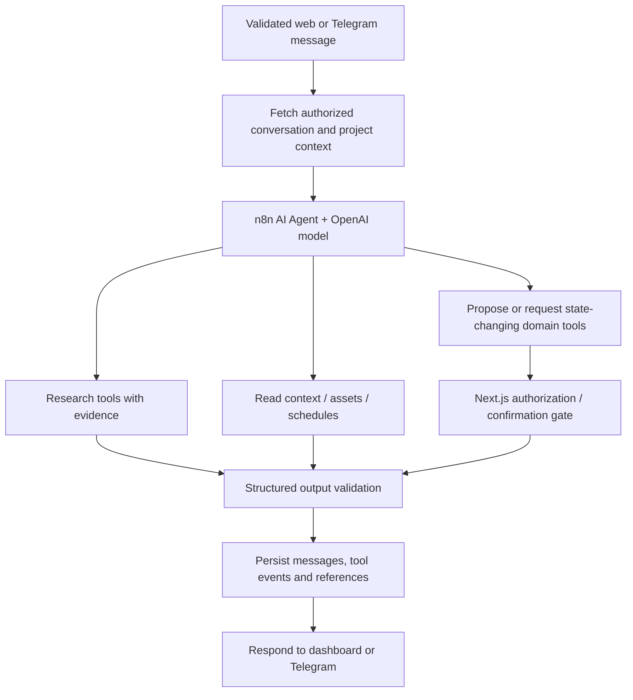
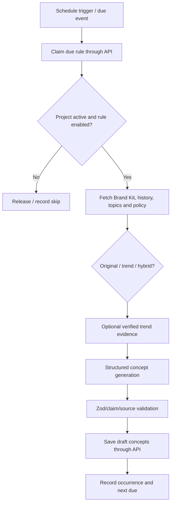
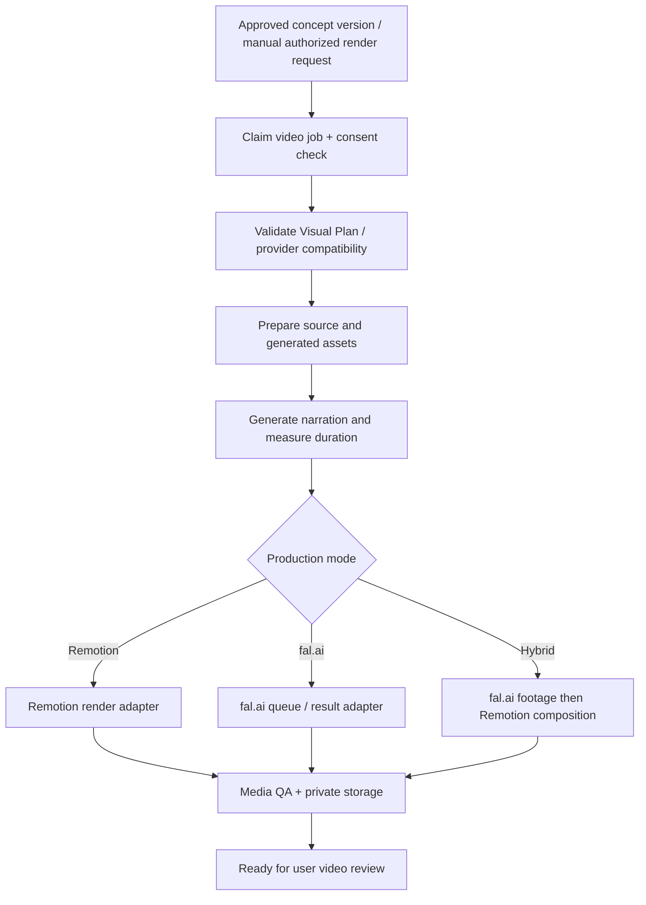
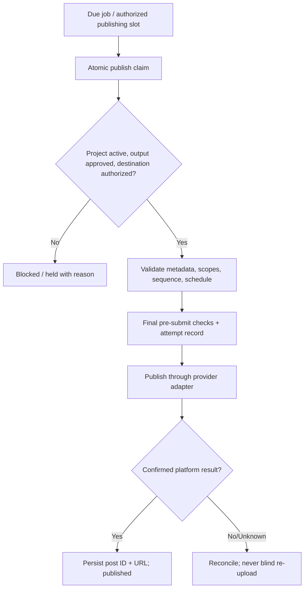

# AI Content Studio — Technical Design Document

**Version:** 2.2  
**Status:** Finalized technical baseline for the complete product; implementation phased by dependency  
**Based on:** `AI-Content-Studio-PRD-v2.1.md`  
**Principal stack:** Next.js / React / TypeScript, n8n, Supabase, OpenAI, Remotion, fal.ai, ElevenLabs, Telegram, social-platform APIs

> This document specifies technical boundaries, data contracts, critical workflows and extensibility for the **entire intended product**. Phases establish implementation sequence and architectural dependency while preserving the complete product scope. Vendor offerings, quotas, compatibility and licenses must be checked when configuring actual integrations.

## 1. Architecture goals and hard decisions

The architecture must support:

1. An **agent-first** workflow: first actionable message → durable planning run → saved Draft Project → independent review of current concept versions → optional Project activation → authorized production → optional separately authorized publishing. Creative work and authorized manual rendering may occur before activation where policy permits.
2. A **Project as the single creative/automation container** for one post, a promotional initiative, a continuing channel or series. No separate required Campaign entity or Ideas Inbox.
3. **The same AI agent** behind dashboard and Telegram, sharing conversations, tools and Project context.
4. **API-first authentication and authoritative domain logic** in Next.js application services; not duplicated in n8n or browser code.
5. **n8n as the central AI agent and workflow orchestrator**, responsible for tool routing, scheduled jobs, asynchronous generation, publishing, retries and notifications.
6. **Supabase PostgreSQL** as the source of truth for data, approvals, durable jobs, execution state and history; Supabase Storage for assets.
7. **Remotion**, **fal.ai** and **Hybrid** provider modes under stable production contracts and immutable attempt/output lineage.
8. Separate, enforceable boundaries for **Project activation**, **concept approval**, **video approval**, **paid generation consent** and **destination-specific publishing authorization**.
9. Pause/resume/stop, revocation, best-effort cancellation, safe retries and externally published/downloaded media behavior.
10. Robust tenancy/access, source provenance, product-claim accuracy, spend control, observability and future team/analytics features.
11. A **single Project aggregate and API contract across Draft/Active/Paused/Stopped**, plus a separate complete Concept Detail contract; no wizard or setup-reviewed persistence model.
12. First activation checks explicitly selected initial launch concepts and their current approved versions, not a synthetic Project approval flag.

### 1.1 Non-negotiable ownership boundaries

| System | Owns | Never treated as authoritative for |
|---|---|---|
| **Next.js UI** | Pages, chat UX, forms, previews, optimistic presentation | Approval decisions without server confirmation; service secrets |
| **Next.js API / domain services** | Session validation, ownership, CRUD, versioning, transitions, consent, job authorization, tool implementation | Heavy media encoding and unattended recurrent scheduling |
| **n8n** | Shared agent graph, LLM/tool orchestration, schedules, external-service coordination, retries, notifications | Bypassing domain APIs or inventing user privileges |
| **Supabase PostgreSQL** | Persistent records, integrity, role security, atomic claims, outbox, audit | Arbitrary LLM workflow execution or rendering |
| **Supabase Storage** | Private user media and provider outputs, signed access | Access policy decisions not backed by Auth/DB |
| **Remotion render environment** | Template-based composition, timeline, video encoding | Prompt interpretation beyond validated render props |
| **fal.ai provider adapters** | Model selection/requests, async results, cancellation when available | User approval or destination authorization |
| **ElevenLabs adapter** | Audio synthesis and provider usage metadata | Script approval or source factual correctness |
| **Telegram gateway** | Delivery/receipt of bot messages and media | Identifying users solely by text, changing server permissions |
| **Publishing adapters** | Destination API protocol, upload/status reconciliation | Product truth about consent or which video is approved |

**Rule of thumb:** Next.js API decides *whether* an action is permitted. n8n decides *how* the permitted job proceeds and records each step. A service callback cannot set `approved=true` directly.

## 2. Recommended stack and deployment roles

| Layer | Technology | Responsibilities / notes |
|---|---|---|
| App web and BFF | **Next.js App Router, React, TypeScript** | Pages, Route Handlers, authenticated BFF and internal API; one application deployment initially |
| UI | Tailwind CSS, shadcn/ui, Motion for React (optional) | Cohesive dashboard, accessible editing, chat and media preview |
| Validation/domain types | TypeScript + Zod | Shared input/output schemas and typed transitions; server validation is mandatory |
| Auth | **Supabase Auth + `@supabase/ssr`** | Cookie-based sessions, verified claims / up-to-date user checks, identity lifecycle |
| Database | **Supabase PostgreSQL** | Relational source of truth, RLS, constraints, transactions, data retention |
| File storage | **Supabase Storage** | Private references, narration audio, storyboards, rendered outputs, signed URLs |
| Agent and workflow engine | **n8n** | Shared creative agent/orchestration, workflow subgraphs, webhooks, Telegram triggers, recurrences; all user OpenAI requests use an authorized provider gateway |
| Reasoning and structured text | **OpenAI API** (replaceable) | Brainstorming, planning, script and storyboard development via Studio-managed or account-specific BYOK credentials resolved by a secure backend gateway |
| Video composition | **Remotion** | Versioned layouts, animated layers, subtitles, timing and MP4 encoding |
| AI video | **fal.ai** models (e.g. eligible Kling/MiniMax models) | Text/image-to-video when supported; model-specific inputs/costs |
| Narration | **ElevenLabs** (replaceable) | Text-to-speech and voice metadata |
| Image generation | Provider adapter | Generated stills, keyframes, backgrounds, visual references |
| Publishing | YouTube then supported social APIs | OAuth and destination-specific upload/metadata/status operations |
| Notifications | In-app + Telegram + optional email | Delivery of workflow status, approvals, failures and usage alerts |
| Deployment/observability | Managed hosting or containers; structured logs | Separate web, n8n and render execution concerns; scale when needed |

**Do not add a separate NestJS/Express API solely because the system has many endpoints.** Next.js Route Handlers and reusable domain packages can provide the API. Introduce a standalone API service if scale, runtime limits or organizational boundaries demonstrate a need.

### 2.1 Runtime topology



The diagram is logical. `n8n` receives only authenticated, scoped user context or internally claimed jobs; it does not query arbitrary user data from the browser. An unlinked web conversation’s first actionable message starts a `project_planning` run, which publishes actual stage events and links its eventual Draft Project transactionally. Telegram sender resolution occurs through an internal API before shared agent tools execute.

### 2.2 Agent request pathways

**Dashboard:** `Browser → POST /api/agent/messages → validated session + conversation membership → create user message → signed internal n8n agent invocation → agent tools through internal API → persist assistant output/tool results → return/stream reply`.

**Telegram:** `Telegram Bot API → n8n Telegram Trigger → validated source update → /api/internal/telegram/resolve-actor → create/deduplicate message → same agent subworkflow → /api/internal/agent/store-results → Telegram reply`.

The shared agent executes the same tool schemas and policy checks for both surfaces. Website login and Telegram bot transport are distinct; no Telegram sender is authorized by a displayed username alone. Use a short-lived signed execution context issued by the application API containing verified actor, conversation, allowed Project scope, nonce and expiry; internal APIs independently verify scope and state.

**Streaming:** If n8n's deployment and webhook mode support the required streaming semantics, bridge them through the application API. Otherwise persist message/job events and use short polling, SSE from the application or a realtime subscription. Do not make the correctness of agent conversations depend on one long-running HTTP connection.

### 2.3 Deployment choices

- **Web/API:** One Next.js deployment with environment-based secrets, controlled server routes, suitable runtime limits and an authenticated internal API.
- **n8n:** n8n Cloud or self-hosted; pick one actual operational model per environment. Queue-mode n8n workers (when scaling) execute workflows; they are **not** Remotion render workers.
- **Remotion:** Dedicated Node render worker, appropriate self-hosted command environment, Remotion Lambda, or managed render environment. High-CPU encoding should not block ordinary web API requests.
- **fal.ai:** Server-side submit/status/result/webhook operations through the integration adapter. Credentials remain off client.
- **Storage:** Supabase buckets organized by owner/Project/asset type with private access and controlled signed URLs.
- **Secrets:** server/runtime secret manager. n8n credentials and social tokens must be scoped, rotated and redacted from logs.

## 3. Repository and modules

```text
ai-content-studio/
  apps/
    web/                         # Next.js pages + public/internal Route Handlers
    render-worker/               # Optional Remotion API / job worker deployment
  packages/
    domain/                      # Authz policies, state machines, atomic transitions, jobs
    schemas/                     # Zod IO contracts, content & agent-tool schemas
    agent-contracts/             # Agent instructions/tool specs/action result envelopes
    creative/                    # Prompt builders, project/brand/context resolvers
    video/                       # Remotion compositions, presets, validators, adapters
    integrations/                # OpenAI, fal.ai, ElevenLabs, platform, research adapters
    ui/                          # Optional shared design system
  n8n/
    workflows/                   # Exported, version-controlled workflow definitions
    fixtures/                    # Test payloads and workflow simulation inputs
    credentials.example.md       # Setup; never real keys
  supabase/
    migrations/                  # SQL schema, RLS, claims/outbox functions
    seed/                        # Test fixtures only
  docs/
    PRD.md
    TDD.md
    API-contracts.md
    operations.md
    provider-capabilities.md
```

**Code ownership:** `domain` contains the real transition logic used by public and internal APIs; `schemas` contains validated boundaries; `creative` normalizes prompts/context; `video` owns deterministic composition; `integrations` owns provider-specific payloads. n8n workflows orchestrate these operations rather than reimplementing the business policies in Code nodes.

## 4. Domain model and persistent state

### 4.1 Main entity relationships



The **initial tenant is the authenticated owner**, with `owner_id` on all major records. Team support later adds `organizations`/`workspace_memberships`, tenant-aware RLS and delegated destination authorization. A shared workspace is not the same thing as a Project, and remains invisible for users who do not need team collaboration.

### 4.2 Project and creative data

#### `projects`

| Column | Type | Description |
|---|---|---|
| `id` | UUID PK | Persistent Project ID |
| `owner_id` | UUID FK auth.users | Owner / initial tenant |
| `name`, `description`, `objective` | TEXT | Editable creative purpose |
| `content_mode` | TEXT CHECK | `independent`, `series` (purpose tags such as `campaign` are optional labels, not separate entity) |
| `status` | TEXT CHECK | `draft`, `active`, `paused`, `stopped`, `archived` |
| `timezone` | TEXT | Valid IANA timezone |
| `default_production_mode` | TEXT CHECK | `remotion`, `fal`, `hybrid` |
| `default_model_id` | TEXT nullable | Provider model registry ID, if selected |
| `preferred_destinations` | JSONB | Non-authoritative default connected-account references |
| `creative_context_version` | INT | Brand Kit version pointer / revision counter |
| `settings_version` | INT | Optimistic concurrency and audit |
| `activated_at`, `paused_at`, `stopped_at` | TIMESTAMPTZ nullable | Lifecycle record |
| `created_at`, `updated_at` | TIMESTAMPTZ | Timestamps |

Project `active` must not imply `auto_publish=true`. Automation eligibility is derived from Project state **and** specific enabled rules **and** consent gates. A one-video Project is a normal Project with one concept and few/no rules.

#### `project_brand_kits`

- `id`, `project_id`, `version`, `language_default`, `tone`, `audience`, `brand_or_creator_name`, `do_say`, `dont_say`, `visual_notes`, `brand_asset_ids`, `reference_profile_ids`, `generation_defaults`, `created_by`, `created_at`.
- Prefer immutable versioned Brand Kit snapshots for traceability; Project references latest version.
- Values such as `do_say` are **approved user/evidence facts**, not permission for the agent to invent additional product specifications.
- Concept versions store the **resolved** context snapshot and constraints used to generate/approve them.
- The user-facing term is **Creative Kit**. The physical `project_brand_kits` table name may remain for migration compatibility; do not introduce a second table for the same concept.
- Structured fields are validated using extendable versioned Zod option catalogs (e.g. language, tone, audience, objective, content structure and visual direction) with optional custom detail strings. Preserve source of each value (`agent_default`, `user_override`, `import`) when needed for safe proposal merges. Explicit user overrides win for future drafts; already approved snapshots stay intact.

#### `concepts`

| Column | Type | Description |
|---|---|---|
| `id`, `project_id`, `owner_id` | UUID | Concept and required parent Project |
| `title`, `original_input` | TEXT | Human-readable and immutable original source text |
| `source` | TEXT | `web`, `telegram`, `agent`, `schedule`, `import` |
| `content_type`, `series_order` | TEXT / INT nullable | Optional classification and episode order |
| `selected_for_initial_launch` | BOOLEAN NOT NULL DEFAULT FALSE | First-activation membership flag; independent of content approval |
| `working_version_id` | UUID nullable | Latest draft/editable version pointer |
| `latest_approved_version_id` | UUID nullable | Latest currently approved version pointer (historical versions remain) |
| `created_at`, `updated_at` | TIMESTAMPTZ | Timestamps |

`concepts.project_id` is **NOT NULL** in v2; there is no separate persistent `idea_entries` inbox. `selected_for_initial_launch` is a **first-activation eligibility selector**, not a quality review state. The first activation event snapshots the selected concept IDs plus their exact approved version IDs. Future content does not enter that frozen initial-launch cohort simply by being added to the Project. Unsaved brainstorming lives in `agent_messages` and can later create a Project and concepts. Source attachments are associated with conversation messages and then Project/Concept assets when saved.

#### `concept_versions`

- `id`, `concept_id`, `version_number`, `review_status` (`draft`,`pending_review`,`approved`), `content` JSONB (strict schema), `brand_kit_snapshot` JSONB, `visual_plan` JSONB, `publishing_pack` JSONB, `source_asset_ids`, `created_by`, `created_at`, `approved_by`, `approved_at`, `approval_revoked_at`, `supersedes_version_id`.
- Approved **payload** is immutable. Approval metadata and revocation are separate state/event records, not unlogged edits of content.
- `UNIQUE(concept_id,version_number)`; foreign keys ensure both working and approved version IDs belong to that concept.
- Updating content after approval always inserts version N+1, preserving the old approved version even if a render/publish job exists.

#### `media_assets`

- `id`, `owner_id`, `project_id` nullable for not-yet-saved chat attachments, `conversation_id` nullable, `concept_id` nullable, `kind`, `storage_bucket`, `storage_path`, `mime_type`, `size_bytes`, `width`, `height`, `duration_ms`, `checksum`, `source_type`, `provider`, `model_id`, `prompt_snapshot`, `source_asset_ids`, `licensing`, `factual_reference_status`, `created_at`, `deleted_at`.
- Use asset identifiers, not arbitrary model-created raw URLs, for approved plans; non-owned external resources must be fetched and validated through controlled ingestion.

### 4.3 Video and publishing data

#### `video_jobs`

| Column | Type | Description |
|---|---|---|
| `id`, `project_id`, `concept_id`, `concept_version_id`, `owner_id` | UUID | Frozen content inputs and ownership |
| `production_mode` | TEXT | `remotion`, `fal`, `hybrid` |
| `requested_provider_model` | TEXT nullable | Model/preset lookup key |
| `render_contract_version` | TEXT | Schema revision for deterministic replays |
| `input_snapshot` | JSONB | Exact visual plan, references, narration and settings |
| `status` | TEXT | `queued`, `preparing`, `generating`, `rendering`, `validating`, `ready_for_review`, `blocked`, `failed`, `cancel_requested`, `cancelled`, `reconciling` |
| `consent_id`, `estimated_cost`, `reserved_cost` | UUID / NUMERIC | Cost authorization and reservation |
| `idempotency_key` | TEXT UNIQUE | Approval+configuration request identity |
| `created_at`, `updated_at` | TIMESTAMPTZ | Timestamps |

`video_jobs` represent production intent for a frozen approved input. User-requested regeneration may create another job sharing the same approved concept version but with a distinct **explicit regeneration request ID**, or additional `video_attempts` inside that job; the API must guarantee both are independently traceable and never overwrite the original output.

#### `video_attempts`

- `id`, `video_job_id`, `attempt_number`, `provider`, `model_id`, `provider_request_id`, `input_checksum`, `settings_snapshot`, `status`, `output_asset_id`, `quality_report`, `estimated_cost`, `actual_cost`, `render_started_at`, `render_finished_at`, `approved_by`, `approved_at`, `approval_revoked_at`, `error_code`, `error_details`.
- `UNIQUE(video_job_id,attempt_number)` and where available unique external provider request identifiers.
- Approval always references a concrete immutable output/attempt, not “the latest video” indirectly.

#### `connected_accounts`

- `id`, `owner_id`, optional `team_id`, `platform`, `provider_account_id`, `display_name`, `credential_reference`, `scopes`, `token_expires_at`, `status` (`connected`,`expired`,`revoked`,`disconnected`), `created_at`, `updated_at`.
- `credential_reference` points to encrypted server-controlled storage or provider credential vault; never expose tokens directly to client or agent prompts.

#### `publishing_jobs`

| Column | Type | Description |
|---|---|---|
| `id`, `owner_id`, `project_id` | UUID | Ownership and Project |
| `video_attempt_id`, `output_asset_id` | UUID | Immutable target output |
| `connected_account_id` | UUID | Exact authorized destination |
| `metadata_snapshot` | JSONB | Exact title/description/visibility/etc. |
| `scheduled_for`, `timezone` | TIMESTAMPTZ / TEXT | Canonical UTC instant and user's intended time zone |
| `authorization_id`, `idempotency_key` | UUID / TEXT UNIQUE | Publishing authority/deduplication |
| `status` | TEXT | `draft_intent`,`blocked`,`scheduled`,`held`,`publishing`,`published`,`failed`,`cancel_requested`,`cancelled`,`reconciling` |
| `provider_post_id`, `provider_url` | TEXT nullable | Real external result |
| `created_at`, `updated_at` | TIMESTAMPTZ | Timestamps |

One publishing job targets **one exact output and one destination**. Multi-platform publishing creates separate jobs. If a source video or metadata is edited, current jobs stay immutable until the user explicitly replaces/cancels/reschedules them. Provider upload attempts should be stored separately for safe retry decisions.

### 4.4 Agent, automation and operational data

#### `agent_conversations` and `agent_messages`

`agent_conversations`: `id`, `owner_id`, `project_id` nullable, `title`, `status`, `created_at`, `updated_at`, `summary_version`, `last_message_at`. `project_id IS NULL` for unlinked early conversation; once assigned it is the **one active Project context** for that conversation. Many conversations may reference the same Project. Relinking to a different Project is a distinct verified action, not an inference from normal message text.

`agent_messages`: `id`, `conversation_id`, `owner_id`, `role`, `content`, `source_surface` (`web`,`telegram`,`system`,`tool`), `source_message_id`, `attachment_ids`, `tool_call_id`, `model_metadata`, `created_at`, `edited_at` nullable.

- Unique transport-dedupe key `(source_surface, source_message_id)` where present.
- Message creation, agent tool decisions and assistant replies are persisted consistently, including timeout/error states.
- Context retrieval follows user+conversation+Project authorization; no cross-user chat memory.
- One conversation has **zero or one active linked Project**. A Project may have many conversations; mentioning another Project in text does not silently reassign the link. Context changes require a validated explicit request.
- New user text that supplies actionable creative intent creates a single idempotent project-planning run and eventual Draft Project without a second generate/accept control.
- Agent summaries are derived cache material and must not overwrite the original conversation log.

#### `telegram_links`

`id`, `owner_id`, `telegram_user_id`, `telegram_chat_id`, `link_challenge_hash`, `linked_at`, `revoked_at`, `default_conversation_id`, optional `preferred_project_id`, `notifications_enabled`. Use source numeric Telegram identifiers; bot/chat usernames are not primary identity keys. Private chats default; group-chat access requires distinct explicit permissions.

#### `automation_rules`

`id`, `owner_id`, `project_id`, `kind` (`ideation`,`publishing_slots`,`notifications`,`analytics`,`research`), `enabled`, `status` (`enabled`,`paused`,`disabled`,`stopped`), `schedule_definition` (typed), `timezone`, `next_due_at`, `last_run_at`, `missed_run_policy`, `strategy`, `policy_snapshot`, `version`, `created_at`, `updated_at`.

`kind=production` may be represented as a **Project production policy** rather than a clock recurrence. Concept approval is the event that creates production intents; it does not have an independent schedule.

#### `approval_events`, `authorization_grants`, `cost_events`

- `approval_events`: actor, object type/id, version/attempt, event (`approved`,`revoked`), policy, reason, time, request ID.
- `authorization_grants`: exact scopes (`activate_project`,`auto_approve_concept`,`auto_approve_video`,`produce_paid_media`,`publish_destination`,`spend_limit`), owner/team actor, Project/destination scope, limit/currency, validity/revocation, policy version.
- `cost_events`: reservation, settled estimate/actual, provider, model, request/job ID, currency, time, event type. Maintain auditable per-user/Project totals and safeguards against double charging records.

#### `workflow_runs`, `outbox_events`, `audit_events`, `notifications`

- `workflow_runs`: internal run ID, owner ID, nullable Project and conversation references, workflow type (including `project_planning`), n8n execution ID, correlation ID, idempotency key, input reference, current stage/status, step statuses, failure category, started/completed times. Project ID may initially be null until the Draft Project is saved.
- `workflow_run_events` (or a durable equivalent): `run_id`, monotonic `sequence`, `stage`, `state`, safe `message`, `available_section_keys`, `error_code`, `created_at`. Authoritative step updates come from authenticated n8n/internal APIs, not client timers. Use an event cursor for resumable polling/SSE; avoid exposing tool secrets or prompt internals.
- `outbox_events`: transactionally committed event type/payload, aggregate/version, due state, claim lease, attempt count, dispatched/acknowledged timestamps; supports durable n8n ingestion.
- `audit_events`: actor (`user`,`agent_tool`,`service`), action, target, before/after safe summaries, time, correlation, source surface.
- `notifications`: owner, Project/job reference, channel, template, delivery state, preference/quiet-hours logic.

### 4.5 Extensible data

- `source_evidence` for source URL, retrieved/observed/published time, facts, confidence and rights notes.
- `trend_signals` for niche- and region-scoped observations with provenance.
- `character_profiles`, `series_episodes`, `scene_references` for recurring stories.
- `model_catalog` and `provider_capabilities` for active fal.ai model parameters, region, constraints, price metadata and last verified time.
- `publishing_slots` or typed scheduling rules for recurring destination-specific schedule windows.
- `platform_metrics`, `insight_snapshots` for authorized performance data and source timestamps.
- `organizations`, `organization_memberships`, `project_memberships`, `review_assignments` for team mode.
- `project_tags`/`project_objectives` can represent promotional campaign metadata without requiring a Campaign entity.

### 4.6 Initial launch and creation-run decisions (v2.1)

- **Do not create** `project_setup_reviews`, `review_steps`, `project_approval_status`, a Project-level `approved` status, or persisted per-tab wizard progression. Tabs and Agent visibility are UI concerns, not authority-bearing domain state.
- For the initial single-launch model, `concepts.selected_for_initial_launch` is sufficient. On first activation, record an **immutable activation snapshot** in `audit_events`/the activation grant containing selected concept IDs and **exact current approved version IDs**. If multi-batch launches later become a separately managed business object, migrate to a `launch_batches`/membership relation rather than overloading this initial flag.
- `workflow_runs` + durable `workflow_run_events` cover automatic new-Project planning. Do not duplicate n8n's execution record as the only source of user-visible progress. Prepared sections can be saved under the Draft Project transactionally, with `available_section_keys` indicating what is ready for read.
- Use a server-validated `current_project_id`/`concept_id` request context for Agent tools. A concept belongs to one Project; adding an Agent panel in another view does **not** create a new conversation automatically if a valid Project-scoped conversation is already selected.
- No database mutation is needed to expand/collapse the sidebar or switch between Content Detail subviews. Do persist unsent input and unsaved form work where appropriate, but never represent local UI state as approval.

## 5. Database invariants, state transitions and access

### 5.1 Hard integrity invariants

1. `concepts.project_id` is required and must reference an authorized Project. A new intention becomes a draft Project before persisted concepts are created.
2. `concept_versions` are immutable once approved. Store edits as new rows under the same `concept_id`.
3. `video_jobs.concept_version_id` must point to an approved version (or an explicitly captured approved snapshot and valid authorization, when a later automatic approval mode is introduced).
4. `video_attempts.output_asset_id` references an owned, finalized, validated asset; `video_attempts` cannot approve a failed or incomplete render.
5. `publishing_jobs.video_attempt_id` references the **exact approved output**, not the current latest attempt. Metadata is snapshotted.
6. Every mutable record is scoped to an owner/tenant and, where applicable, a Project. Foreign keys and authorization verify cross-table consistency.
7. Idempotency constraints cover actor-triggered approvals, render requests, schedule occurrences, provider callbacks and publishing requests.
8. `connected_accounts` may be referenced only through valid owner/team authorization; destination tokens never enter ordinary public read models.
9. An event may enter `published` only after confirmed platform evidence (provider post ID/result or a documented authoritative verification), never merely after an n8n node starts.
10. A paused/stopped/archived Project or disabled rule cannot claim new automatic work. Authorized manual actions are explicit and independently checked.
11. On first Project activation, the selected initial-launch set is nonempty and each selected concept’s **working_version_id equals an approved, non-revoked version** of that same concept. A prior approved version is insufficient if a newer working revision is pending.
12. A Draft Project has no special access/approval scope: all authorized Project and Concept Detail reads/writes use the same ownership rules as Active/Paused Projects.
13. Any agent planning run is idempotently associated with one initiating message; retries, reloads or duplicate transport updates cannot create duplicate Draft Projects.

### 5.2 Access model

- Enable Supabase RLS on all user-facing tables. A simple initial policy checks `owner_id = auth.uid()` or an approved member role where enabled.
- Cross-entity access must use join-safe checks: owning a `video_attempt` requires access to its `video_job`, `concept_version`, `concept`, and Project.
- Public API queries use a per-request Supabase server client bound to the verified user, or domain services that enforce equivalent access; client-supplied `owner_id` is ignored.
- Internal workflows authenticate with distinct service credentials and act only on **claimed, scoped job IDs**. Do not give generic n8n agent nodes unrestricted service-role access to the database.
- For privileged internal transactions, put narrow `SECURITY DEFINER` functions or protected domain endpoints behind authorization checks, fixed search paths and audited service identities.
- In team mode, use explicit tenant IDs/role grants rather than assuming personal ownership covers all shared operations.

### 5.3 Example atomic transition rules

**First Activate Project** (single transaction; **not** a wizard action):

1. Verify authenticated actor's Project ownership/activation permission, expected `settings_version`, and that status is `draft`. For resumed or previously stopped Projects, use the separately defined resume/reactivation transition and revalidate current rules without re-running the first-launch gate.
2. Lock the Project/selection rows and read current Creative Kit and rule configuration plus all concepts with `selected_for_initial_launch = true` in a **serializable transaction or equivalent lock/version-checked transaction**. Require at least one selected concept. Use retry-on-serialization-failure and bounded idempotency behavior; a concurrent content edit must not slip between validation and activation.
3. For every selected concept, require `working_version_id` to reference its **latest approved, non-revoked** immutable version; reject stale/edited/pending versions. Verify all selected content belongs to the Project and passes necessary content constraints.
4. Validate enabled rule schedule definitions, destinations, budget/consent scopes and timezone. Missing paid-generation or publication authorization must not be fabricated or inherited from activation; those workflows remain blocked/awaiting consent.
5. Persist an activation grant and an immutable audit snapshot of selected `(concept_id, approved_version_id)` pairs and effective Project/rule settings. Set Project status `active` and calculate due occurrences only for enabled, explicitly authorized rules.
6. Commit audit/outbox events and the state transition atomically; return actual enabled/blocked rules, next occurrences and the frozen initial-launch set. Do not bulk-render historical approved concepts simply because activation succeeded.
7. If version checks or launch membership changed concurrently, return `409 VERSION_CONFLICT`/`INITIAL_LAUNCH_NOT_READY` with precise missing items; never partially activate.

**Approve concept version**:

1. Verify ownership/reviewer role, expected version, valid structured content and factual constraints.
2. Atomically append approval event and assign latest approved pointer; reject stale edits with a `409 CONFLICT` response.
3. If configured production policy permits, reserve/authorize cost and enqueue **one** production intent with a unique key, otherwise mark as `awaiting_cost_authorization` or awaiting explicit manual render.
4. Write outbox event and return the approved version ID and any job status.
5. Do not affect existing scheduled publishing jobs or already-running renders of older approved versions.

**Approve video attempt**:

1. Verify finalized output exists, quality checks passed or authorized override is recorded, and actor can approve.
2. Record approval event on that exact attempt.
3. Make it eligible for future authorized publishing; do not publish without a destination-specific grant/job.

**Pause/revoke/stop**:

1. Persist state and audit event synchronously.
2. Prevent new claims immediately through DB checks and lease conditions.
3. Mark pending not-started jobs as `held`/`blocked` or cancellation requested as appropriate.
4. Signal n8n/provider cancellation where supported; reconcile in-flight outcomes asynchronously.
5. Do not report external action as cancelled until confirmed.

### 5.4 Outbox and job claiming

Use a **transactional outbox** for approvals and scheduling intents, not only fire-and-forget HTTP triggers:

- Commit domain change and `outbox_events` record atomically.
- n8n polls/receives a notification and atomically claims the event through a protected API.
- Claim lease includes `claimed_by`, expiry, attempt count, and dedupe key; competing workers cannot both act on the same job.
- Every critical stage rechecks active Project/rule state, relevant approval, budget, actor authorization and destination permissions immediately before its **external side effect**.
- Completed events are acknowledged idempotently. Expired leases may be re-claimed only after recovery policy checks.
- Use a uniqueness key per schedule occurrence such as `(rule_id, scheduled_occurrence_at)` rather than just date. Do not double-produce for DST/restarts.
- DB is the durable command queue; n8n execution history is supplementary evidence, not the queue of record.

## 6. API architecture and contracts

### 6.1 API groups

The web and its Route Handlers live in one Next.js application. Use shared domain services under `packages/domain` (or an equivalent `apps/web/src/server` module) rather than placing all business logic in route files. Names below are illustrative versioned paths; finalize OpenAPI schemas before implementation.

#### Public user APIs (session verified)

| Method | Endpoint | Responsibility |
|---|---|---|
| POST | `/api/auth/login` | Delegate credential verification to Supabase Auth; establish secure cookie session |
| POST | `/api/auth/logout` | Clear session/cookies and perform available token revocation |
| GET | `/api/auth/me` | Return verified profile and access scopes |
| GET | `/api/overview` | Authorized aggregate for new/returning Overview: Project counts, review needs, due jobs, warnings and activity |
| POST | `/api/agent/messages` | Persist message; first actionable unlinked message idempotently creates and triggers a `project_planning` run, with no extra Generate action |
| GET | `/api/agent/runs/:id` | Read own durable planning/agent run, current stage, partial sections and failure/needs-input status |
| GET | `/api/agent/runs/:id/events` | Cursor-based durable progress events; optionally served over SSE with polling fallback |
| GET | `/api/agent/conversations/:id` | Retrieve authorized chat history and Project links |
| POST | `/api/agent/conversations/:id/link-project` | Explicit verified link or context switch to an authorized existing Project; agent auto-created Draft Project can be linked transactionally without a separate user confirmation |
| POST | `/api/projects` | Create a Draft Project manually or through a tool-authorized planning run; idempotent project creation from the first actionable request needs no additional user click |
| GET | `/api/projects` | Paginated authorized list across all lifecycle statuses with filters/search |
| GET/PATCH | `/api/projects/:id` | Read/update one canonical Project aggregate for Draft/Active/Paused/Stopped, with expected version |
| PATCH | `/api/projects/:id/initial-launch` | Update selected launch concept IDs prior to first activation, with ownership and version guards |
| GET | `/api/concepts` | Paginated authorized list across Projects with search/status/project filters |
| GET | `/api/concepts/:id` | Full Concept Detail: working/approved version, script, storyboard, assets, Publishing Pack, versions and linked output summaries |
| GET | `/api/concepts/:id/versions` | Paginated version history, approved snapshots and render lineage |
| GET | `/api/videos` | Authorized output/attempt list with review status, Project and provider filters |
| POST | `/api/projects/:id/activate` | Persist selected rules/consent; activate automation |
| POST | `/api/projects/:id/pause` | Hold future auto execution |
| POST | `/api/projects/:id/resume` | Reenable future rule occurrences with missed-run policy |
| POST | `/api/projects/:id/stop` | Disable project automation indefinitely |
| POST | `/api/projects/:id/archive` | Archive after checking outstanding jobs |
| POST/GET | `/api/projects/:id/concepts` | Create/list concepts under Project |
| POST | `/api/concepts/:id/versions` | Create new working version on Edit |
| POST | `/api/concept-versions/:id/approve` | Approve exact immutable version |
| POST | `/api/concept-versions/:id/revoke` | Revoke authorization for future work |
| POST | `/api/concept-versions/:id/render` | Explicit manual production request with consent |
| GET | `/api/video-jobs/:id` | Return status, cost, attempts, output URLs subject to access |
| POST | `/api/video-jobs/:id/regenerate` | Create authorized independent attempt/request |
| POST | `/api/video-attempts/:id/approve` | Approve one exact output |
| POST | `/api/video-attempts/:id/revoke` | Hold future publishing on the selected attempt |
| POST | `/api/publishing-jobs` | Authorize specific output/account/metadata/time |
| PATCH/POST | `/api/publishing-jobs/:id/hold` | Hold not-yet-publishing job |
| POST | `/api/publishing-jobs/:id/cancel` | Request cancellation; reconcile external provider if necessary |
| GET | `/api/automation/rules` | Review configured rules and next occurrences |
| PATCH | `/api/automation/rules/:id` | Update/enable/pause/stop one rule |
| GET | `/api/operations/workflow-runs` | Show execution and error history |
| POST | `/api/integrations/telegram/link` | Start account-link challenge |
| POST | `/api/integrations/telegram/unlink` | Revoke a Telegram identity link |
| GET/POST | `/api/integrations/social/...` | OAuth connect, callback, list, disconnect |
| POST | `/api/assets/upload-intent` | Validate media size/type and issue scoped upload authorization |

Request types carry `Idempotency-Key` for consequential POST operations and `expectedVersion`/`If-Match` for editable versioned records. All POST/PATCH routes enforce CSRF defense appropriate to cookie-authenticated requests.

#### Trusted internal APIs (service authenticated, least privilege)

| Method | Endpoint | Responsibility |
|---|---|---|
| POST | `/api/internal/agent/resolve-context` | Resolve actor/conversation/Project policy for a signed agent request |
| POST | `/api/internal/agent/tool` | Execute one allowlisted, scoped domain tool operation |
| POST | `/api/internal/agent/record-result` | Persist agent reply, tool metadata and safe source references |
| POST | `/api/internal/agent/record-progress` | Verify signed run context; append durable planning stage event and update workflow run/available draft sections |
| POST | `/api/internal/telegram/resolve-actor` | Resolve verified sender mapping, link state and allowed conversations |
| POST | `/api/internal/jobs/claim` | Claim one eligible job/lease after state and budget checks |
| POST | `/api/internal/jobs/progress` | Store bounded, validated step updates |
| POST | `/api/internal/jobs/complete` | Record result, assets, cost and outbox event |
| POST | `/api/internal/jobs/fail` | Record classified failure/hold/reconciliation status |
| POST | `/api/internal/automation/claim-due` | Claim due recurring rules/slots without duplication |
| POST | `/api/internal/publish/authorize-claim` | Final permission, project, output and connected-account check |
| POST | `/api/internal/providers/callback` | Verify provider signature/correlation and record async events |
| POST | `/api/internal/workflows/record-error` | Record n8n error execution ID and related object |

Never trust an `owner_id` passed by n8n or Telegram without matching it to a verified signed context/job claim. Limit each internal service identity to the operations it needs; use rotation, replay detection and expiring signed requests.

### 6.2 API-first login sequence



- Use `@supabase/ssr` session handling with the framework's supported cookie refresh mechanism.
- `getClaims()` or a fresh Auth user check is appropriate for authorization; do **not** trust unverified user objects from client-provided session JSON.
- Set secure cookie flags (`Secure` over HTTPS, appropriate `HttpOnly` and `SameSite` according to library flow and CSRF design). Align SSR client behavior with current Supabase guidance.
- Do not implement custom password storage, password hashing or a client-visible service-role key.
- Apply rate limits and safe credential error messages; rotate/revoke sessions when warranted.

### 6.3 Action envelope (illustrative)

```json
{
  "requestId": "7c6c8a4e-6d9d-41e1-9f9c-6d0d8528a2e5",
  "status": "accepted",
  "data": {
    "projectId": "5e76ab22-1741-47df-a9c6-8ee8e6328d2b",
    "projectStatus": "active",
    "enabledRuleIds": ["66e809a1-7bfe-4b84-aed7-89c30f8f1983"]
  },
  "error": null,
  "correlationId": "c12c9f33-0a9b-476d-a0cf-ded3ced11cab"
}
```

For a rejected state transition from the server, return a standard error code, safe user message, conflict target, and correlation ID, e.g. `APPROVAL_REQUIRED`, `PROJECT_PAUSED`, `BUDGET_AUTHORIZATION_REQUIRED`, `DESTINATION_NOT_CONNECTED`, `VERSION_CONFLICT`, `PROVIDER_OUTCOME_UNKNOWN`. Prefer `202 Accepted` for long-running jobs and return a poll/subscribe URL rather than holding the request open until media is ready.

### 6.4 Agent tool interface

Expose **narrow action tools** to the n8n agent, each validated and backed by authoritative Next.js domain services:

| Tool | Allowed behavior |
|---|---|
| `get_project_context` | Read Project, Brand Kit, approved references and permissions |
| `search_project_content` | Retrieve owned concepts/versions and recent duplicate candidates |
| `propose_project` | Return an editable structured proposal without activating automation |
| `create_draft_project` | Idempotently save validated Draft Project from a user-initiated planning run, without a second Generate/Accept click; do not activate it |
| `propose_concepts` | Return content proposals, original sources and evidence citations |
| `save_concept_drafts` | Persist validated concepts under an authorized Project |
| `revise_concept` | Create new working version of same concept |
| `propose_visual_plan` | Create validated storyboard and asset list for editing/review |
| `research_products` | Retrieve permitted external evidence; return source/caveats |
| `research_trends` | Retrieve dated trend signals and source metadata |
| `get_workflow_status` | Read run/job/next-schedule state for user's Project |
| `propose_automation_changes` | Prepare an editable settings diff; do not silently activate it |
| `request_project_activation` | Require explicit user confirmation and call authorized API |
| `request_paid_generation` | Require approval/cost policy and specific output contract |
| `request_publication` | Require account, output, metadata and destination-specific authorization |

A chat instruction like “go ahead and automate everything” is **not** sufficient proof that a paid render or public social post is authorized. Model output only selects candidate actions; server-side tools enforce actor permissions and approved inputs. Destructive tools (delete/unpublish/disconnect) are individually gated and not automatically exposed to all agent sessions.

## 7. Shared agent implementation

### 7.1 Agent subworkflow structure



- One **shared core agent workflow**, invoked by both surface-specific gateways. Separate gateway workflows handle transport-specific messages, attachments, rate limiting and response formatting.
- The agent retrieves the user's Project context **at tool invocation time**, not from stale preloaded memory alone.
- It distinguishes a **proposal** from a **committed mutation**. Display editable plan previews first; state-changing tools require permitted consent.
- Keep structured data outputs and tool schemas versioned with Zod; reject/repair malformed outputs using bounded retries, not unbounded LLM loops.
- Limit message/context/token budgets, tool-call depth, attachment sizes and expensive research queries.
- Detect and handle prompt injection inside retrieved pages, product references, attachments and prior tool output by keeping system/tool policies separate from data.
- Store explanations and source links without implying that the agent verified unavailable information.

### 7.2 Conversation state, automatic planning and concurrency

- Source of truth is `agent_conversations`/`agent_messages`. n8n memory subnodes may be used as cached context, but not as the only durable conversation history.
- Use conversation-level serialization or optimistic versioning to prevent Telegram and web messages racing to edit the same Project based on stale context.
- Every agent action includes actor, originating surface, conversation ID, optional Project ID, expected version and request ID.
- Upon `VERSION_CONFLICT`, the agent refreshes the current Project and presents a proposed reconciliation instead of overwriting the latest human edits.
- A conversation may begin with `project_id=null`; when the draft Project is saved, attach it to the conversation through an authorized API action.
- Messages should support text, image, link, optional voice/transcription and media references; attachments are ingested securely and converted into owned asset IDs.
- Conversation export, retention and deletion are explicit user/tenant controls. Summaries are invalidated when underlying messages or Project context change.

### 7.3 Telegram account linking

1. Signed-in user initiates linking from Settings; API creates a short-lived single-use challenge tied to the account.
2. User sends the challenge to the official bot through a direct chat (or opens a deep link); bot transport is authenticated with the configured Telegram token/webhook.
3. Gateway sends the raw Telegram sender/chat identifiers and challenge to `/api/internal/telegram/resolve-actor`.
4. API validates single-use challenge and records `telegram_links`; never link by username alone.
5. Later messages are deduplicated by update ID, resolved to an owner/conversation and passed through the shared agent tool policy.
6. Revocation or user disconnect disables access immediately; pending bot messages cannot re-link the account without a new challenge.

Bot authorization to publish, spend or alter automation does not come from bot transport alone. High-impact actions require account-level signed confirmation or a safe deep-link/web approval if transport assurance is insufficient. Groups are disabled by default unless a separate group-access model is built.

### 7.4 Human-in-the-loop action proposals

The agent may prepare structured Project drafts and changes with states: `proposed`, `needs_clarification`, `awaiting_confirmation`, `committed`, `failed`.

- **Low impact:** brainstorm/propose concepts and save drafts within configured creation permissions.
- **Medium impact:** change existing Project settings/content; require actor authorization and concurrency checks, optionally confirmation based on scope.
- **High impact:** activate/stop workflows, approve media automatically, spend above policy, connect social account, publish/unpublish; always use explicit consent capture and policy checks.
- A proposal can expire or become stale; agent must revalidate before commit and never treat an old chat “yes” as perpetual authorization.
- The UI and Telegram response show whether a change is only a suggestion, saved as a draft, queued, running or completed.

## 8. AI creative contracts and Visual Production Plan

### 8.1 Typed creative outputs

Use shared schemas and JSON structured outputs for:

- `ProjectProposalSchema`: `name`, `objective`, `audience`, `brandKitDraft`, `contentMode`, `conceptProposals[]`, `referenceNeeds[]`, `productionDefaults`, `automationProposal[]`, `preferredPublishing`, `assumptions[]`, `missingFacts[]`, `sources[]`.
- `ConceptVersionSchema`: `originalInput`, `title`, `angle`, `hook`, `script`, `story`, `language`, `voiceDirection`, `cta`, `sourceFacts[]`, `creativeConstraints`, `publishingPack`, `visualPlan`.
- `VisualPlanSchema`: metadata plus ordered validated scenes, source asset requirements, motion design and timeline.
- `AgentActionProposalSchema`: typed action, target, expected version, proposed changes, authorization class and source IDs.
- `RenderRequestSchema`: approved concept version, production mode, selected provider/model, exact scene/asset IDs, snapshot, output settings, consent and idempotency.
- `PublicationRequestSchema`: approved output, connected account, metadata snapshot, schedule, visibility, authorization grant and idempotency.

Return missing-fact and source-provenance information in separate fields rather than hiding limitations in prose. Schema validation is server-side and re-run before the first paid render. Providers may have model-specific adapters but never change the stable domain contract.

### 8.2 Canonical Visual Production Plan

The plan exists to make video output **visually intentional**. It is an edit-friendly data document, not model-generated executable React code.

```json
{
  "schemaVersion": "2.0",
  "format": { "aspectRatio": "9:16", "width": 1080, "height": 1920, "fps": 30 },
  "language": "id",
  "targetDurationMs": 15000,
  "creativeObjective": "Playful mini fan product introduction",
  "visualStyle": { "palette": ["#CDEFF8", "#1D446A"], "typographyPreset": "bold-sans", "mood": "energetic" },
  "referenceAssetIds": ["asset-product-photo"],
  "audio": { "narrationText": "Kipas mini untuk aktivitas sehari-hari.", "voicePreset": "id-energetic", "subtitles": true, "musicAssetId": null },
  "scenes": [
    {
      "id": "hook",
      "role": "hook",
      "startMs": 0,
      "durationMs": 4000,
      "onScreenText": "Butuh angin sejuk?",
      "assetStrategy": "designed_graphics",
      "assets": [],
      "layoutPreset": "kinetic_title",
      "motionPreset": "impact_reveal",
      "layers": [{ "kind": "shape", "position": "full_bleed", "animation": "wave" }],
      "transitionOut": "push",
      "narrationSegmentIds": ["seg-1"]
    },
    {
      "id": "showcase",
      "role": "product_showcase",
      "startMs": 4000,
      "durationMs": 7500,
      "onScreenText": "Kecil, praktis, siap dibawa",
      "assetStrategy": "supplied_image",
      "assets": ["asset-product-photo"],
      "layoutPreset": "product_hero",
      "motionPreset": "product_push_in",
      "layers": [{ "kind": "image", "assetId": "asset-product-photo", "position": "center" }],
      "transitionOut": "wipe",
      "narrationSegmentIds": ["seg-2"]
    },
    {
      "id": "outro",
      "role": "call_to_action",
      "startMs": 11500,
      "durationMs": 3500,
      "onScreenText": "Lihat detail produknya",
      "assetStrategy": "designed_graphics",
      "assets": [],
      "layoutPreset": "cta_card",
      "motionPreset": "bounce_in",
      "layers": [],
      "transitionOut": "none",
      "narrationSegmentIds": ["seg-3"]
    }
  ],
  "safeAreas": { "topPct": 0.08, "bottomPct": 0.16 },
  "disclaimer": "Only user-provided/verified product claims may be displayed"
}
```

Values above are illustrative (placeholder asset IDs are **not** real database IDs). The actual schema uses owned UUIDs and validates `startMs`, scene ordering, total duration, source type, available layout/motion presets, font constraints, aspect ratio, `dont_say`, asset rights and narration coverage. `fps`, resolution and model format must be verified for the chosen renderer/provider.

### 8.3 Visual planning constraints

- Separate **creative intent** (what viewers see) from **execution capabilities** (which presets/models can achieve it).
- AI can suggest camera moves, layouts and transitions only within a supported renderer vocabulary; unsupported suggestions are flagged for revision or mapped to a tested alternative with user visibility.
- Product/reference photos preserve actual product identity where necessary; generative images are not silently substituted for authentic merchandise photographs.
- Compose safe-area-aware typography and subtitle layers; detect overflow, insufficient contrast and missing assets before render.
- Measure narration duration and align clips/transitions with real speech; adjust scene timing transparently.
- Reuse approved assets when regenerating without changing their associated facts or rights metadata.
- Generated video snippets are **scene assets** until composed into an approved output. Audio from the generative provider must be intentionally retained, replaced or muted.

### 8.4 Prompt/context building

Compose agent prompts from: system policy; tool descriptions; authorized Project objective; effective Brand Kit/forbidden claims; original user input; linked reference assets; confirmed product facts/source evidence; previous approved concepts/series history; selected output language; requested creative action; provider capability limits. Keep user/scraped content as **data**, not instructions.

Each AI-generated output records model/prompt version, source IDs, request ID, input content hash, content language, references and validation status. No LLM-based “trend” claim is considered verified without dated source evidence.

## 9. Video provider and rendering design

### 9.1 Unified production modes

| `production_mode` | Adapter | Output behavior |
|---|---|---|
| `remotion` | Remotion render runtime | Composes supplied/generated imagery, animated graphics, subtitles and voice into MP4 |
| `fal` | fal.ai async model adapter | Creates AI video footage; optional postprocessing for required format/audio/captions |
| `hybrid` | fal.ai(s) → Remotion composition | Generate moving scenes/footage then add deterministic edits, overlay, titles, captions and audio |

The **model** is a choice *within* the fal.ai mode or hybrid generation stage. Selecting Remotion does not select a generative model. Provider availability, commercial licenses, pricing and input capabilities must be refreshed from configured provider metadata rather than assumed constant.

### 9.2 Renderer adapter contract (illustrative)

```ts
export type ProductionMode = 'remotion' | 'fal' | 'hybrid';

export interface ApprovedRenderRequest {
  jobId: string;
  conceptVersionId: string;
  productionMode: ProductionMode;
  providerModelId?: string;
  sourceAssetIds: string[];
  visualPlan: VisualProductionPlan;
  renderSettings: { aspectRatio: string; targetDurationMs: number; resolution: string };
  authorizationId: string;
  correlationId: string;
}

export interface RenderingAdapter {
  estimate(request: ApprovedRenderRequest): Promise<ProviderEstimate>;
  submit(request: ApprovedRenderRequest): Promise<{ externalJobId: string; state: 'queued' | 'running' }>;
  status(externalJobId: string): Promise<RenderProgress>;
  fetchResult(externalJobId: string): Promise<RenderedMedia | null>;
  cancel?(externalJobId: string): Promise<{ requested: boolean; confirmed: boolean }>;
}
```

Keep provider-specific options inside validated adapter-owned config and a versioned model registry; do not pass unfiltered LLM JSON directly to third-party APIs. A completed external request becomes a media asset only after server-side validation and controlled ingestion.

### 9.3 Remotion composition runtime

- Maintain developer-authored templates/layouts: kinetic title, product hero, story/illustration, split screen, quote/card, multi-image collage, CTA, outro.
- Maintain curated animation presets: parallax, product push-in, mask reveal, graphic overlay, bounce, slide, layered depth, pan/zoom, typography sequencing and transitions.
- Generate scene composition props from the validated Visual Plan and asset URLs; restrict media/file access and sanitize text/asset names.
- Use React/Remotion Player (where appropriate) for accurate preview; final render uses a controlled server runtime or managed environment and the same input props.
- Render worker downloads authorized media through short-lived signed URLs, produces file(s), performs quality checks, uploads private output, and reports back via authenticated callback.
- Version `templateId`, `templateVersion`, render code version, input props, source assets, font IDs and encoder settings for repeatability.
- Background music and SFX have licensing metadata; avoid unintended overriding of narration.

### 9.4 fal.ai execution

1. API validates approved concept, mode/model capability, spend grant, source rights and scene references.
2. n8n production workflow calls server-side integration adapter to submit generation to fal.ai's queue interface.
3. Persist external request ID and associated model/parameters. Return control immediately; do not hold ordinary API or n8n executions open unnecessarily.
4. Receive verified webhook or poll queue status/results; correlate to the exact internal job/attempt and ignore duplicate/out-of-order callbacks.
5. Download output into controlled private media storage, validate type/duration/ownership/rights, calculate actual cost when available.
6. For pure AI video, apply any required audio/subtitle/format postprocessing before offering for review; for Hybrid, hand clip IDs to Remotion.
7. On provider failure, classify error, apply bounded retry policy only if safe, then expose failure/blocked status and alternative models if suitable.

**Model capability registry** records endpoint, generation mode (`text_to_video`, `image_to_video`, both), duration choices, dimension/aspect ratio rules, audio behavior, price basis, generation limits, commercial usage terms, enabled regions, last checked timestamp and supported cancellation/retry semantics.

### 9.5 Hybrid strategy

- Prepare reference/keyframe images as needed (could use user product photos or generated illustrations).
- Generate eligible clips with fal.ai for scenes that benefit from moving visuals; keep text, branding, subtitles and CTA deterministic in Remotion.
- Normalize footage durations, frame sizes and audio channels before final composition.
- If a clip fails, clearly offer retry, alternate model, manual supplied-asset fallback or intentional Remotion graphics; do not silently claim completion with missing scene footage.
- Each clip request has its own cost and lineage; final hybrid render links to clip asset IDs and final composition template version.

### 9.6 Narration and timeline synchronization

- Synthesize narration after approval or in a consented preview stage as appropriate; store voice ID, provider response, input text and actual duration.
- Split narration into timed sections; derive reliable scene bounds from audio length and intended pacing.
- If narration exceeds target duration, propose script edits or length adjustment rather than truncating the audio silently.
- Generate/edit captions from narration timing; track caption text language separately from UI and output metadata language.
- For AI footage with native audio, choose an intentional mixing policy: use native, mute and replace with ElevenLabs, or mix with licensed music/SFX.

### 9.7 Output validation and review contract

Before `ready_for_review`, verify: playable media, readable format/dimensions, expected orientation/duration, audio track integrity, source asset availability, safe areas/text overflow where computable, correct output access policy, and links to exact concept/provider attempt. Human approval or configured quality policy remains necessary before publishing. Render validation does not imply publication consent.

## 10. n8n workflow design

n8n is the **shared agent execution and asynchronous orchestration layer**. It receives authenticated, scoped requests and claimed events/jobs and invokes domain APIs for state transitions. Workflow IDs are logical and can be implemented as reusable subworkflows to avoid giant node graphs.

| Workflow | Entry trigger | Purpose | Durable output |
|---|---|---|---|
| **WF-A1 Agent Gateway — Web** | Authenticated Next.js request | Normalize request, call shared agent workflow, return/persist result | Message/run/tool events |
| **WF-A2 Agent Gateway — Telegram** | Telegram Trigger | Sender resolution, attachment intake, call shared agent, bot response | Verified message + same conversation history |
| **WF-A3 Shared Creative Agent** | Called by either gateway | Plan Projects/concepts, use scoped tools, propose changes, explain states | Agent response and authorized domain changes |
| **WF-01 Scheduled Ideation** | Due automation rule | Generate context-aware concepts and trend evidence when configured | Reviewable concepts, next due time |
| **WF-02 Content Production** | Approved concept/render intent | Prepare assets, voice, selected video mode, output | Render attempts ready for video review |
| **WF-03 Scheduled Publishing** | Due publishing job/slot | Recheck permissions, upload to destination, reconcile | Provider post ID/URL or blocked/failure |
| **WF-04 Error/Recovery** | n8n Error Trigger / job failure | Classify, store, safely retry or request human intervention | Diagnosable run and notification |
| **WF-05 Trend Research** | Research request or due refresh | Fetch dated sources, rank Project relevance, store provenance | Source evidence and trend signals |
| **WF-06 Notifications** | Outbox status/review event | Send in-app, Telegram, email according to preferences | Delivery receipt or error |
| **WF-07 Platform Analytics** | Due authorized data refresh | Collect performance/engagement metrics | Timestamped metrics and insights |
| **WF-08 Provider Reconciliation** | Recovered/outstanding jobs | Poll unknown render/publish state, prevent duplicate side effects | Confirmed or still-uncertain outcome |

### WF-A1/A2/A3 — Shared conversational agent and new-Project planning

1. Ingress persists validated message and attachment IDs with sender identity, conversation ID, source surface and a unique transport ID.
2. Agent subworkflow fetches the authorized Project and recent conversation context from the API. For the first actionable creative request in an unlinked conversation, the ingress has already created an idempotent `project_planning` run; the shared Agent works with `project_id=null` until an authorized Draft Project is saved. The first message provides the scope for **draft planning only**, not paid generation, activation or publishing.
3. During planning, n8n records verified stage transitions and partial-ready sections through the protected progress API. Final draft creation and conversation linkage are committed idempotently, and the browser can resume observing them through a cursor read.
4. Agent decides which **read/propose** tools to call. External research is source-labeled and subject to allowlist/policy.
5. State-changing tool calls are authorized against actor, Project, expected version and action-specific confirmation/consent by the application API. Authorized **draft creation** does not require a secondary Generate confirmation.
6. Agent result and tool outcomes persist before the surface receives its reply. For Telegram, return short messages/media summaries and secure links to rich dashboard editors.
7. When network/LLM errors occur, save recoverable message state and never report a Project action succeeded until committed by API.

### WF-01 — Scheduled ideation



- Use original-only behavior if configured; never label fabricated or stale signals as live trends.
- Scheduled concepts stay reviewable unless explicit automatic concept approval policy exists.
- Deduplicate against recent backlog and series characters; write run costs and source evidence.
- Record occurrence identity and next due transactionally so scheduler restarts cannot duplicate creations.

### WF-02 — Approval-driven video production



- Persist the job before triggering workflow; an approval event is not an ephemeral queue.
- Recheck approval/Project/rule/spend grants **before** incurring charge or starting rendering. A manual render request is a separate explicit grant.
- Store provider request IDs and asset provenance; external callbacks must be authenticated and idempotent.
- Each attempt has an independent cost outcome and status. Regenerate does not reuse a published output ID. Changing a script, product claim, or substantive storyboard element first creates a newly reviewed concept version; provider/preset changes may create a fresh attempt using the same approved content only when they do not alter its substantive approved meaning.
- Completion yields `ready_for_review`; does **not** automatically approve unless explicitly permitted by an audited policy.

### WF-03 — Publishing



- A due publishing slot with no eligible approved media safely skips or holds without creative-generation side effects.
- Each multi-destination delivery is a separate job and has its own authorization, metadata and provider attempt history.
- Once provider submission begins, cancellation is best effort; an ambiguous timeout moves to `reconciling` instead of automatic duplicate upload.
- Publishing policies may enforce series order, destination privacy and local-platform requirements.

### WF-04 — Errors and safe recovery

- Use n8n Error Trigger where appropriate and explicit application error reporting for non-n8n failures.
- Categorize: validation, auth/permission, spend/credits, rate limit, provider outage, provider ambiguous outcome, media/codec, missing references, expired OAuth, project paused and policy changed.
- Bounded backoff retries only for recoverable, **idempotent** operations; never blindly retry a potentially successful platform upload or non-idempotent paid generation without reconciliation.
- Preserve correlation IDs, sanitized provider messages, attempts and safe manual actions.
- Trigger notifications based on severity and user preferences.

### WF-05/06/07/08 — Research, notices, analytics and reconciliation

- **Trend research:** verified provider feeds and source timelines; dedupe, relevance to Project, locale, age of source and terms-of-use checks.
- **Notifications:** prepared or approved videos, agent requests for clarification, failures and scheduled post results; honor quiet hours, Telegram link status and opt-in rules.
- **Analytics:** authorized platform polling/webhooks normalize metrics; store source collection time, account identity, data quality and rate-limit behavior.
- **Reconciliation:** retry orphaned job claims, late provider callbacks and uncertain publishes without pretending a failed HTTP connection means remote publication failed.

## 11. Scheduling, state control and concurrency

### 11.1 Three independent execution concepts

1. **Ideation recurrence:** Project automation rule decides when new ideas are proposed. In `active + enabled` state, n8n claims due occurrences and creates draft concepts.
2. **Video production event:** Approval of an exact concept version (or a separately authorized manual render request) creates an eligible job. This is **not** a separate time-based schedule.
3. **Publishing recurrence/one-time job:** Authorized publishing slots/jobs choose **already approved** video outputs for specific destinations at known times. These schedules do not imply content approval or provider spend authorization.

Timezone is stored as an **IANA zone**, with the canonical due instant in UTC. On daylight saving transitions, select and document a consistent policy for skipped/duplicated local wall times; the occurrence key always uses a unique canonical timestamp or slot instance ID.

### 11.2 Pause, stop and resume semantics

| State/action | New ideation | New auto production claims | New scheduled publishing claims | Existing in-flight work |
|---|---|---|---|---|
| Draft | No | Only explicitly authorized manual work | No automatic jobs | None, unless manual work requested |
| Active | Enabled rules only | Approval + production policy + consent | Authorized jobs/slots only | Proceed with continued state rechecks |
| Pause | Held | Held | Held | Cancellation requested where safe; actual provider outcome reconciled |
| Resume | Future occurrences restored | Eligible outstanding jobs reviewed | Stale publishing jobs held for review | Reconcile prior uncertain operations |
| Stop | Disabled indefinitely | No automatic claims | No automatic claims | Request cancellation and record completion/uncertainty |
| Archive | Disabled | No new automatic claims | Hold/cancel pending | Preserve historical outputs and audit |

**Default missed-run policy:** skip missed ideation recurrences; do not publish a scheduled post whose intended time passed while paused without explicit user-approved rescheduling. Alternative catch-up policies may be offered and recorded explicitly.

Manual editing, browsing, agent brainstorming and downloading previously authorized assets may remain available while Project is paused/stopped. Manual video generation requires a separate explicit consent and must not be confused with automation being resumed.

### 11.3 Approval revocation matrix

| Object/action | Before work starts | While external request runs | After output/publishing completes |
|---|---|---|---|
| Concept approval revoked | Block new render claims | Request cancellation; track ambiguity | Historical render remains; future work blocked |
| Video approval revoked | Hold/block future publish jobs | If upload is in progress, reconcile before declaring cancelled | Published copy remains external; unpublish is separate action |
| Production rule disabled | No new automatic render jobs | Hold/cancel only as configured | Retain completed assets |
| Project paused/stopped | No new automatic claims | Cancel best effort and check again before next charge/upload | Preserve completed output/history |
| Social account disconnected | Block destination claims | Provider behavior varies; reconcile | Existing public posts may remain; disconnect is not unpublish |
| Concept edited | Create new version; old job references old version | No silent live input mutation | Old scheduled/published jobs stay linked to old output |

A user-visible `cancel_requested` is **not** an assertion that the remote provider has stopped. If the provider cannot confirm cancellation, use `reconciling` and report provider fees or outcome if discovered.

### 11.4 Idempotency and leases

| Operation | Stable idempotency identity |
|---|---|
| Process Telegram message | `telegram:bot_id:update_id` |
| Save agent tool outcome | `conversation_id:tool_call_id` |
| Project activation | `project_id:settings_version:activation_request_id` |
| Recurring ideation | `automation_rule_id:scheduled_occurrence_at` |
| Concept approval | `concept_version_id:approval_request_id` |
| Production intent | `concept_version_id:production_policy_version:request_id` |
| Regenerate attempt | `approved_concept_version_id:explicit_regeneration_request_id` |
| fal.ai callback | `provider:model:external_request_id:event_identity` |
| Scheduled publishing | `video_attempt_id:connected_account_id:scheduled_slot_id:request_id` |
| Provider post reconciliation | `publishing_job_id:provider_post_id` where available |

A user retrying the same HTTP request with the same key receives the existing result, not duplicate charges. Regeneration is a **new explicit request**, not a network retry. Use optimistic `settings_version` and database row locks or atomic SQL functions to avoid race conditions between pause, approval, schedule claim and provider submission.

### 11.5 Retried external actions

- **Read-only work:** retry with backoff/rate-limit awareness.
- **Idempotent creation with provider key:** retry according to documented provider guarantees.
- **Chargeable video inference without provider idempotency:** reconcile external request ID first; don't create a second generation just because polling timed out.
- **Social publishing with uncertain outcome:** query provider post state using job metadata and tokens; never blindly re-upload.
- **Cancellation:** only display confirmed cancellation after external acknowledgement; otherwise report requested/in progress/unknown.
- **Scheduled rule claim:** uniqueness and expiry leases guarantee at-most-one *claim at a time*, while end-to-end delivery requires reconciliation for truly exactly-once user-visible outcomes.

## 12. OAuth, social publishing and downloadable media

### 12.1 Social connection flow

1. Signed-in user requests a platform connection in Settings or at Publish.
2. API creates an anti-CSRF `state` value and any provider-required PKCE challenge; scopes are least privilege.
3. OAuth redirects to provider consent and back to a verified server callback.
4. Server validates state/PKCE, exchanges authorization safely, identifies external account/channel and stores encrypted credentials or secure reference.
5. UI shows connected account, scopes, status, expiry/reconnect and disconnect options.
6. n8n invokes publishing only through an authorized internal adapter/job, with credentials resolved server-side or through a constrained secret integration, not exposed to agent text.

A user may connect several channels per platform. A Project's preferred destination is a default, not an authorization grant. Do not claim self-service OAuth is functional until the relevant platform's actual API/permissions have been validated.

### 12.2 Publishing adapter contract

```ts
interface PublishingAdapter {
  validateDestination(account: ConnectedAccount, meta: PublishingMetadata): Promise<ValidationResult>;
  publish(request: AuthorizedPublishingRequest): Promise<PublishedResult | PendingProviderResult>;
  getStatus(providerRequestId: string): Promise<PublishedResult | PendingProviderResult | UnknownResult>;
  cancel?(providerRequestId: string): Promise<CancellationResult>;
  updateMetadata?(providerPostId: string, metadata: PublishingMetadata): Promise<PublishedResult>;
  removePost?(providerPostId: string): Promise<RemovalResult>;
}
```

The application API checks the authorization immediately before `publish`, even when a scheduled rule already claimed the job. Protect downstream platform attempts from duplication by saving the exact external request/post identity and tracking ambiguous outcomes separately.

### 12.3 Publishing metadata and file lineage

- Publishing job snapshots caption/title/hashtags/description/visibility, thumbnail, language, scheduled time, video attempt ID, destination account and authorization grant.
- Platform-specific fields are validated against the chosen destination's current limits and required scopes.
- After successful upload, store provider post ID, canonical URL where returned, raw safe result summary, actual publish time and retries.
- Updating an already-published title/description or removing a post is a **new explicitly authorized platform operation** with its own audit trail.
- A new render cannot replace a platform-uploaded video by changing an internal pointer. Reposting is a separate publishing job.

### 12.4 Downloads and data deletion

- MP4 download is an authorized signed media URL or server stream; no social account required.
- A previously downloaded local copy cannot be recalled by revoking Studio approval.
- Local deletion is separate from external platform removal and provider artifact retention.
- Implement storage retention and deletion policies by media type, user/tenant request, active references, legal/audit retention and provider terms.

## 13. Media, rights and source provenance

- Every asset records its origin: user upload, generated image, generated footage, licensed asset, stock reference or composition output.
- Signed URLs should be short-lived and access scoped; avoid public Supabase buckets for private user content by default.
- External image/product URLs supplied to the agent should pass through safe URL fetch, size/MIME validation, malware screening as appropriate and SSRF controls. Model-origin URLs are not trusted simply because they look like a CDN.
- Product factual claims are backed by `source_evidence` or user-provided approved facts; an image is not proof of technical specifications.
- Asset licensing fields distinguish permitted promotional use, required attribution, provider terms, unknown rights and restricted commercial uses.
- Preserve prompt and model/version lineage for AI-generated material, while avoiding storing unnecessary secrets in prompt logs.
- For series, store canonical character/world references, approved previous episode summaries and source visuals. They inform next episodes without overwriting established canon.

## 14. Security, privacy and threat model

| Threat | Required mitigation |
|---|---|
| Session forgery / unverified browser identity | API-first Supabase Auth, verify claims/current user, secure cookie handling, proper CSRF checks |
| Privilege escalation via n8n agent tool | Signed scoped agent context, allowlisted tools, internal API authorization and per-actor audit |
| Telegram impersonation | Verify sender/source update, challenge-based account link, numeric identifiers, bot token protection |
| Prompt injection via webpage or attachment | Treat retrieved text as untrusted data; never grant tool powers based on source content |
| Cross-user or cross-Project leakage | RLS, owner/tenant checks across joins, scoped media URLs, context retrieval authorization |
| Exposed provider/API credentials | Encrypted vault/server secrets, limited n8n credentials, never place tokens in browser or LLM prompts |
| Callback spoof/replay | Verify provider signature/HMAC if offered, exact request IDs, expirations/nonces, deduplication |
| Paid generation abuse | Project/user budgets, per-model caps, rate limits, authorization grants and cost reservations |
| Duplicate posting | Atomic claims, provider status reconciliation, persisted external identities and safe retry policy |
| Unauthorized external publication | Separate video approval + destination authorization + final pre-submit policy check |
| Media upload abuse | Size/type limits, validation, private storage, virus scanning as applicable, safe previews |
| SSRF/open redirect | URL allowlist/network policies, no unconstrained server-side URL fetching, validated OAuth redirects |
| Data leakage through logs | Redact credentials, user chat/media, access tokens and sensitive provider payloads; limit retention |
| Team data exposure | Tenant-aware RLS, project roles, invite validation, delegated destination authorization |

### 14.1 Audit trail expectations

Every approval, revocation, Project state change, automation rule update, spending authorization, external account change, publishing request, platform post change and destructive action must capture *who, what, when, originating surface, target version and outcome*. Agent-initiated changes are attributed to the verified user **and** identify agent/tool provenance. A chat message alone is not authoritative evidence of success; committed domain events are.

## 15. Operations, monitoring and cost governance

### 15.1 Traceability

- Assign one correlation ID per user request or scheduled occurrence and propagate it to n8n, internal APIs, provider job records and render worker callbacks.
- Store normalized step states and durations for ideation, asset preparation, TTS, render, upload, source research and notifications.
- Dashboard shows Project state, rule status/next due, concept and video approval, generation costs, failed/blocked items and actual platform post outcomes.
- Support operational dashboards and alerting for provider error spikes, repeated job leases, queue backlog, absent scheduled runs, expiring OAuth and budget exhaustion.
- Never report `published` for an unconfirmed or uncertain upload; use `reconciling`.

### 15.2 Cost policies

1. Model registry supplies price basis, compatible options and a `price_last_verified_at` field; estimates are not guarantees.
2. Before expensive work, estimate cost using provider/model, requested duration/resolution, scene count, TTS length and any composition infrastructure.
3. Reserve authorized budget atomically against user/Project quotas before claim; settle with actual provider usage and refund/release difference where appropriate.
4. Never charge twice internally for a duplicated callback; regeneration is separately attributable.
5. When a provider reports unexpected overage, block new work exceeding the configured policy and notify user.
6. Record external spend in the provider's billing currency and an optional display-currency estimate with exchange timestamp, not silently mixed units.
7. Budget authorization is a distinct scope from creative approval and publishing permission.

### 15.3 Reliability and scalability progression

- Start with durable DB claims/outbox and clear web/n8n/render separation; don't prematurely split every domain into microservices.
- Scale agent traffic using n8n workflow concurrency controls and a bounded tool execution budget; scale media rendering independently from n8n execution workers.
- Use backpressure, per-provider rate limits, exponential backoff, dead-letter/blocked states, idempotent callbacks and operator recovery tools.
- Support versioned workflow exports and environment-specific secrets without putting production credentials in Git.
- Monitor schema/database performance and add indexes for `(project_id,status)`, due times, job leases, publication status, conversation ordering and provider IDs as required by queries.

## 16. Testing and validation strategy

### 16.1 Contract/unit tests

- Zod schemas reject invalid concept/visual plans, unsupported scene presets, malformed provider settings and missing destination scope.
- Domain tests cover approval versions, edit-after-approval, Project activation policies, pause/resume/stop, revocation and publishing eligibility.
- First-activation tests cover empty launch selection; mixed approved/unapproved launch items; a newly edited but not yet reapproved working version; revoked approval; concurrent selection edits; invalid time zone/rules; and successful activation with zero recurring rules.
- Cost policy tests prove requests cannot bypass reservation/cap when called from Telegram, Next.js or an n8n service identity.
- Timestamp tests cover daily schedules, timezone/DST policy, duplicate due-claim requests and missed-run handling.
- Render tests verify caption safe areas, animation preset mapping, scene timeline, narration duration, output shape and asset access validation.

### 16.2 Security/integration tests

- Supabase RLS: user A cannot read or mutate user B's Project, media, concepts, conversations, attempts or social accounts.
- Invalid/expired cookie and unauthenticated Route Handlers return the correct response; forged requests cannot use service-role secrets.
- Agent tools cannot override Project ownership or call publishing without a valid action grant.
- Unlinked Telegram sender, repeated challenge, reused bot update or spoofed callback cannot mutate a Project.
- Provider callback replay, out-of-order status and external request mismatch do not alter unrelated jobs.
- OAuth state/PKCE failures and token expiry block the corresponding destination while leaving content safe.

### 16.3 End-to-end user scenarios

| Case | Expected result |
|---|---|
| New affiliate intention through web chat | First actionable message creates one durable planning run without a secondary button; progress survives refresh; agent creates and links one Draft Project |
| Reopen a Draft Project | Same canonical Project data/actions and Agent access as an Active Project; no Review wizard or setup-reviewed marker |
| Open Content Detail | Full script, storyboard, scene assets, Publishing Pack and version history for one concept without Project setup controls |
| First activation with selected concepts | Requires ≥1 launch item and approval of each selected item’s current working version; unselected drafts do not block activation |
| One product image through Telegram | Linked user gets a one-concept draft Project, references attached, same state visible on web |
| Add content to existing Project | New concept created under existing Project, Brand Kit and rule context inherited |
| Activate Project with ideation only | Future ideation occurs; no paid render or publishing occurs without separate conditions |
| Approve concept then produce via Remotion | Output references approved version, visual plan, assets, audio and provider attempt |
| Render same concept via fal.ai | Separate attempt with model/cost/output, original Remotion result unchanged |
| Hybrid mode | Generated footage is composed with deterministic branding/voice and validated media output |
| Regenerate after video review | Separate render attempt; earlier media and scheduled posts preserved |
| Edit approved concept | Working version N+1 created; previous approved output/schedule untouched |
| Revoke video approval before scheduled time | New publishing claim blocked/held, no unauthorized external upload |
| Pause during external generation | Best-effort cancel, clear `cancel_requested`/reconciliation state, no false cancellation claim |
| Resume after missed publish window | Stale job held for explicit reschedule, not silently published late |
| Disconnect destination | Pending jobs blocked; download remains available; prior external posts remain historical |
| Publish request times out after remote upload | `reconciling`; provider lookup before any retry; no blind duplicate upload |
| Two simultaneous chat edits | Conflict detected; current version preserved and reconciliation proposed |
| Automatic approval policies enabled | Only scoped, budget-capped, audited activity proceeds; publish still requires separate grant |
| Series publishing | Required episode order enforced when configured; missing prior episode safely holds later one |

### 16.4 Operational fault injection

Test n8n restart mid-run, expired job lease, duplicate webhook, provider rate limiting, no voice credits, invalid render asset, corrupt MP4, insufficient storage, timezone changes, account revocation, backend outage before callback, uncertain publish result and forced Project stop during active processing. Assert **actual outcome** rather than assuming the initiating HTTP status tells the full story.

## 17. Implementation phases and dependency gates

These are design priorities for an evolving complete product, without an artificial feature cap. A phase is considered ready when its **dependency contracts and quality checks** work, not merely when the UI is present.

### Phase 1 — Application and shared agent foundation

- Next.js App Router web app, API-first Supabase authentication and ownership/RLS.
- Shared Zod/domain API contracts, Project/Brand Kit lifecycle, immutable concepts/versions, approval and activation service rules.
- n8n core agent workflow, web chat gateway, durable conversation history, limited safe agent tools and first Telegram account-linking/gateway contracts.
- Agent-generated Project plans, multiple concepts, interactive editing and validated storyboard/Visual Production Plan.
- Workflow run/outbox/idempotency foundations and initial monitoring/cost-consent surface.

**Gate:** New independent intention becomes editable Draft Project through agent; user can continue in same Project, see permissioned state and approve a version without bypassing API.

### Phase 2 — Creative video production

- Remotion compositional layout library, rich supplied/generated assets, audio/TTS and subtitle alignment.
- fal.ai model registry/provider requests, queue/callback processing and cost preview; Hybrid generation and final composition.
- Durable production jobs, outputs/attempts and comparison; **Approve / Regenerate**, download and revocation rules.
- Render environment selection and media quality validation.

**Gate:** Same approved concept can produce and compare eligible provider outputs; old outputs remain immutable and costs/QA are visible.

### Phase 3 — Automation and external distribution

- Full recurring ideation, source-aware trend feeds, independent publishing slots/queues and missed-run behavior.
- Project/per-rule Pause/Resume/Stop, reconciliation and error recovery.
- Full Telegram agent continuity (attachments, conversational project/idea changes, notifications and safe high-impact confirmations).
- Per-user publishing OAuth, YouTube then supported destinations; authorized publishing, post tracking and schedule/calendar.

**Gate:** Project activation and schedules operate independently, approval and permission gates hold under concurrency, linked Telegram reaches the same durable state, platform results are truthful.

### Phase 4 — Advanced creative and organization features

- Additional image/video models, richer multi-scene editing, visual continuity libraries, multi-language localization, alternate aspect ratios and composition tooling.
- Teams/tenant isolation, roles and delegated review, shared brand libraries.
- Advanced platform insights, experimentation, optimizer suggestions, budgets/billing and high-volume scaling.

**Gate:** Multi-user access and analytics preserve existing lineage, permissions, quality, provider abstraction and workflow observability.

## 18. Migration and compatibility from v1.3

This is a **design migration plan**, not permission to change existing user tables without an explicit production migration. For a fresh v2.0 implementation, adopt the canonical model directly.

| v1.3 element | v2.0 direction |
|---|---|
| `idea_entries` / global Idea Inbox | Not a required entity. New independent intentions create draft Projects; temporary exploration lives in conversations. Existing idea rows can be migrated to draft Projects or attached to explicit existing Projects through a user-visible migration. |
| `campaigns` grouping table | Not required. Campaign is a possible Project purpose/tag. Preserve old campaign metadata where relevant to Project objectives; do not collapse unrelated active Projects automatically. |
| Independent chat/intake interactions | Shared n8n agent plus dashboard and Telegram gateways; common persistent conversations and tool schemas. |
| Interactive AI partly in Next.js | Next.js remains API/domain authority; core conversational agent and tool orchestration in n8n. |
| Concept/video negative review states | Primary user flow becomes **Approve / Edit** and **Approve / Regenerate**. Map legacy non-approved records to neutral draft/review states with history retained. |
| Project `active/archived` only | Expand to Draft, Active, Paused, Stopped, Archived with explicit lifecycle transitions. |
| Render approach in content metadata | Explicit `production_mode` (`remotion`,`fal`,`hybrid`), model registry and independent attempts. |
| Telegram intake bot | Full shared-agent conversation surface with account link and cross-device continuity. |
| Optional self-service web login | Required API-first Supabase Auth session boundary for both app and internal operations. |
| Approval/rejection semantics | Immutable version approvals, separate explicit authorization grants and revocation events for future operations. |

**Data migration safeguards:** preserve existing IDs where practical, keep old approval/render/publish history, backfill nullable fields conservatively, apply RLS before exposing new tables, add unique constraints after deduplication, test old active jobs and do not change scheduled publishing intent without user-visible migration behavior.

## 19. Architectural decision records

| ID | Decision | Rationale |
|---|---|---|
| ADR-01 | One primary Project container | Supports one post to channel/series without hierarchy overhead |
| ADR-02 | Agent-first creation, default Draft Project | Users begin with intentions rather than forms or manual categorization |
| ADR-03 | One shared n8n agent across web/Telegram | Central AI orchestration and consistent tools/context |
| ADR-04 | Next.js API is the authority | Prevents unauthorized state changes and logic duplication |
| ADR-05 | Supabase PostgreSQL is durable truth | Atomic transitions, RLS, history and workflow recovery |
| ADR-06 | Project Activate ≠ concept/video/publishing approval | Avoids uncontrolled rendering or external publication |
| ADR-07 | Version/attempt snapshots are immutable | Safe revisions and reproducible publication lineage |
| ADR-08 | Remotion/fal.ai/Hybrid behind adapters | User comparisons, provider evolution and cost transparency |
| ADR-09 | Two schedules plus event production | Independent ideation and distribution, no unnecessary render cadence |
| ADR-10 | Transactional outbox and claim APIs | Reliable work under retries/concurrency and external side effects |
| ADR-11 | Render runtime separate from web latency path | CPU/media workloads isolated; worker topology selectable |
| ADR-12 | Telegram sender is linked, not inherently trusted | Transport identity isn't authorization |
| ADR-13 | Publish and download are separate outcomes | Platform OAuth optional; downloaded copies are not recallable |
| ADR-14 | Positive review UI only | Concept Approve/Edit; Video Approve/Regenerate |
| ADR-15 | One Project aggregate for every lifecycle state | No draft-only wizard or additional Project-approved status; standard authorized APIs |
| ADR-16 | Automatic, durable first-message planning | Workflow-run events and idempotent draft creation; no Generate confirmation |
| ADR-17 | Initial launch selection ≠ concept approval | First-activation snapshot locks exact current approved versions; later content not forced into initial launch |
| ADR-18 | Dedicated complete Concept Detail | Rich versioned storyboard/script/publishing metadata reads separate from Project overview |

## 20. Open engineering decisions and validation checkpoints

- Select n8n Cloud or self-hosted for each environment; verify webhook streaming, execution limits, credential storage and workflow concurrency.
- Choose initial Remotion rendering runtime and capacity model; determine whether local worker, dedicated hosted renderer or managed Lambda fits expected output volume/licensing.
- Validate the current fal.ai models, endpoint support, aspect/duration/audio/cost constraints and reliable cancellation semantics before exposing model selectors.
- Finalize exact Supabase Auth SSR cookie approach, route runtime configuration and social OAuth callback deployment strategy.
- Choose source/evidence providers for product recommendations and legally permissible trend research.
- Determine how strict auto-approval policies and publishing grants will be represented in the UX and signed consent records.
- Verify YouTube and other platform scopes/quotas/publishing rules against current platform policies; do not promise a connector not yet authorized.
- Determine provider price refresh cadence, spend reservation precision and accounting for ambiguous costs.
- Set concrete retention, backup, disaster recovery, monitoring SLOs and role matrices once real operating requirements are measured.

## 21. v2.1 domain and API contract examples

Examples below are **normative for intended business semantics**, but URLs and exact payload shapes remain implementation contracts to finalize in OpenAPI and Zod before coding. They do not describe actual deployed endpoints.

### 21.1 New conversation and planning run

`POST /api/agent/messages` with `{ conversationId?: UUID, text, attachmentIds?: UUID[], idempotencyKey }`:

1. Verify session and validate conversation ownership (or create an unlinked conversation). Persist the user message exactly once.
2. For first **actionable creative intent** in an unlinked conversation, atomically create one `workflow_runs(type=project_planning, conversation_id, idempotency_key, status=queued)` plus an outbox trigger; return `202` with `{conversationId, messageId, runId, state}`. Simple greetings and missing critical context may produce an Agent reply/`needs_input` instead of a misleading completed draft.
3. n8n claims the run, records authoritative stages (`interpreting`, `researching`, `creative_direction`, `concepts`, `configuration`, `finalizing`) as events, and saves validated draft sections as ready. Stage naming/order may evolve; **do not report invented percentages**.
4. Draft creation is an idempotent domain operation keyed by `runId`. Link `agent_conversations.project_id` once, record a `project_created` event and emit a ready stage. On retry, return the **same** Project ID.
5. Browser reads `GET /api/agent/runs/:id` for a snapshot and `GET /api/agent/runs/:id/events?after=<cursor>` for incremental stages. An SSE transport is an optional efficiency enhancement; cursor polling remains a supported correctness path.
6. Permission/cancellation/timeout failures are persisted as `needs_input`, `failed`, `cancelled` or `partial` with recoverable user-facing reason and retry policy; never silently delete completed draft sections.

### 21.2 Canonical Project aggregate and initial launch

The Project read contract is **status-independent**. It includes `id`, `status`, `settingsVersion`, `goal`, creative-kit version, automation proposals/effective rules, concept summaries, initial-launch membership, assets, activity and authorized current actions. UI tab selection is not part of the authoritative Project lifecycle.

Before first activation, `PATCH /api/projects/:id/initial-launch` accepts `{ selectedConceptIds: UUID[], expectedSettingsVersion }`. Server validates ownership, Project draft state, same-Project membership, and updates the selection atomically; concurrency conflicts return 409. Selection by itself **never approves** a concept and does not queue generation.

`POST /api/projects/:id/activate` accepts `{ expectedSettingsVersion, enabledRuleIds: UUID[], acknowledgmentOfRules: true, idempotencyKey }`. In one transaction it checks launch membership, exact current approved version, rule validity and actor authorization. It returns selected approved `(conceptId,versionId)` pairs, actual enabled/blocked rule states and next occurrences. Paid generation and destination publishing grant IDs, when used, are validated independently; their absence is never cured by activation.

`POST /api/projects/:id/resume` and stopped-Project reactivation remain distinct lifecycle transitions. **Do not require a user to reapprove the initial launch merely to resume a previously active Project.** Existing paused/held jobs still obey revalidation.

### 21.3 Dedicated Concept Detail and versions

`GET /api/concepts/:id` resolves:

```json
{
  "id": "concept-uuid",
  "projectId": "project-uuid",
  "selectedForInitialLaunch": true,
  "workingVersionId": "version-uuid",
  "latestApprovedVersionId": null,
  "workingVersion": {
    "id": "version-uuid",
    "reviewStatus": "pending_review",
    "brief": { "objective": "...", "hook": "...", "audience": "..." },
    "script": { "language": "id", "segments": [] },
    "visualPlan": { "scenes": [] },
    "assetIds": [],
    "publishingPack": {},
    "creativeKitSnapshot": {}
  },
  "versionSummaries": [],
  "outputSummaries": []
}
```

- `concept_versions` is still the immutable content source of truth. An approved version's script, scenes, kit snapshot and Publishing Pack cannot be edited in place.
- Rich scene edits create a new working version via the existing version API; approval calls the existing exact-version endpoint. Draft Project status does not bypass content permissions.
- Production requests must reference **approved version IDs** and independent cost/production consent; video attempt approval still references an exact output and does not publish.

### 21.4 Creative Kit typed options and override semantics

- Maintain versioned Zod-controlled **option catalogs** for common language/tone/audience/objective/content-structure/visual-style choices. The catalog is an input UX aid and validation contract, **not a new domain entity or fixed Postgres ENUM requirement**.
- Suggested values include machine-readable `value`, readable `label`, optional `customDetails`, and provenance (agent suggestion vs user-confirmed). User confirmation takes priority over future automatic suggestions; agent may propose a change without overwriting a user selection.
- Use `project_brand_kits` version records for effective Creative Kit; existing relational naming may be preserved. Each approved concept captures the effective context snapshot and relevant verified source claims.

### 21.5 Overview/read APIs, pagination and data security

- `GET /api/overview`: authorized summarized counts, reviewable items, upcoming schedules, failures, recent Projects and cost alerts, with server-computed timestamps/next due times. Support an empty state; do not trust client counts for authority.
- `GET /api/projects`, `GET /api/concepts`, `GET /api/videos`: paginated, owner-scoped lists with bounded page size, stable sort/cursor, controlled filters and policy-safe status labels.
- `GET /api/concepts/:id`, version history and associated assets: enforce ownership/tenant membership on **each referenced entity** and issue signed media access where appropriate.
- All read/edit APIs used by Agent tools execute within verified user/Project scope. No cross-Project information appears merely because the Agent panel is open.

### 21.6 Required tests for this revision

1. Repeated initial chat request/replayed webhook produces **one** planning run and **one** Draft Project.
2. Lost client connection/restored session resumes run stages and sees consistent partial results.
3. Draft/Active/Paused/Stopped Project reads use a unified ownership contract; no extra wizard/approved-Project state.
4. Launch selection and concept approval remain independent; edited unapproved working version fails first activation even if an older approved version exists.
5. First activation is atomic against concurrent edits and records selected concept/version snapshot; subsequent resume does not rerun initial-launch gate.
6. Opening Content Detail, changing kit settings and rendering from chat or direct UI obey the same exact-version and cost policies.
7. Published/downloaded or scheduled outputs remain pinned to exact historical media and metadata, even after revised content approval.

## 22. Official documentation references

Technical feasibility references consulted for the architecture; integration behavior and pricing should be revalidated during implementation:

- Next.js Route Handlers and Backend-for-Frontend: https://nextjs.org/docs/app/getting-started/route-handlers and https://nextjs.org/docs/app/guides/backend-for-frontend
- Supabase server-side Auth and Next.js clients: https://supabase.com/docs/guides/auth/server-side and https://supabase.com/docs/guides/auth/server-side/creating-a-client?framework=nextjs&queryGroups=framework&router=app
- n8n AI Agent node: https://docs.n8n.io/integrations/builtin/cluster-nodes/root-nodes/n8n-nodes-langchain.agent/
- n8n Telegram Trigger: https://docs.n8n.io/integrations/builtin/trigger-nodes/n8n-nodes-base.telegramtrigger/
- n8n queue-mode architecture: https://docs.n8n.io/hosting/scaling/queue-mode/
- Remotion rendering: https://www.remotion.dev/docs/render and https://www.remotion.dev/docs/parameterized-rendering
- fal.ai queued requests/results: https://fal.ai/docs/api-reference/inference-api/queue/submit-path and https://fal.ai/docs/api-reference/inference-api/queue/status and https://fal.ai/docs/api-reference/inference-api/queue/result

---

**End of TDD v2.1**


## 23. OpenAI provider ownership, managed allowances and BYOK (v2.2)

**Architecture decision.** Implement the account-level OpenAI source preference without creating one n8n credential per customer. **n8n orchestrates tool and agent workflows; Next.js domain services resolve authorization, policy and encrypted provider credentials; a trusted server-side AI Provider Gateway actually calls the OpenAI API.** The raw OpenAI key must not enter the browser after the initial one-time submission, n8n workflow variables, model prompts, tool outputs, or ordinary execution logs.

### 23.1 Data model and credential isolation

- `ai_provider_preferences`: `(owner_id PK, openai_mode ['managed','byok'], preferred_model_id nullable, version, updated_at)`. Default `managed`; allow per-Project overrides only if explicitly added later with clear precedence.
- `ai_provider_connections`: `(id, owner_id, provider ['openai'], secret_reference, key_fingerprint, last4, status ['pending','connected','invalid','revoked','disconnected'], verified_at, last_error_code, rotated_at, created_at, updated_at)`; **never store or return plaintext keys** in general application tables. Key fingerprint is a non-reversible keyed digest, not a recoverable copy.
- `ai_usage_events`: `(id, owner_id, project_id nullable, conversation_id nullable, workflow_run_id nullable, provider, billing_mode, model_id, request_id, idempotency_key, estimated_input_tokens nullable, actual_input_tokens nullable, actual_output_tokens nullable, estimated_cost nullable, cost_currency, status, observed_at)`. Record distinct reservation, settlement and failure events or use an adjacent ledger. Provider-reported usage can arrive late; reconcile exactly once.
- `ai_usage_policy`: plan/billing policy per account, window dates/timezone, allowance, per-minute request/token ceilings, allowed models, max concurrency, alert thresholds. Prefer plan configuration tables over hardcoded amounts. Pricing/credits are a product and billing decision, not a UI constant.
- Credentials reside in a backend-controlled KMS/vault or application-encrypted secret store with envelope encryption and strict service identity. RLS + domain ownership checks govern preference metadata. Audit `connected`, `tested`, `rotated`, `disconnected`, and `mode_switched` events **without exposing secret values**.

### 23.2 API contracts (proposed)

| Method | Path | Contract and safeguards |
|---|---|---|
| GET | `/api/settings/ai-provider` | Account's effective OpenAI mode, key last4/status, supported models, quotas, observed usage; no raw key |
| PUT | `/api/settings/ai-provider/mode` | Switch `managed` / `byok` with `expectedVersion`; require valid connected key before BYOK is effective |
| POST | `/api/settings/ai-provider/openai` | One-time key submission over TLS; session+CSRF+re-auth as appropriate; validate, encrypt, verify and discard transient plaintext |
| POST | `/api/settings/ai-provider/openai/test` | Rate-limited, bounded harmless provider check using stored secret; return classified result only |
| PUT | `/api/settings/ai-provider/openai` | Replace stored key atomically after verification; invalidate active secret reference and audit rotation |
| DELETE | `/api/settings/ai-provider/openai` | Disconnect/disable future BYOK use; do not delete historical request/usage events |
| GET | `/api/settings/ai-usage` | Managed quota and correlated observed provider usage with limitations, reset period |
| POST | `/api/internal/ai/execute` | Trusted gateway invocation with signed scoped run/job identity, requested operation/schema, model capability; never accepts a caller-supplied raw key |
| POST | `/api/internal/ai/check-policy` | Return safe, nonsecret mode/model/quota eligibility and request authorization reference |

**Gateway order:** authenticate trusted caller → resolve owner and permitted Project/job → select chosen mode at request time → validate model/capability and rate limits → reserve managed allowance if applicable → securely resolve corresponding secret → request OpenAI → validate normalized structured response → settle token/cost usage and record correlation → return content or a classified error to n8n. Long responses must use bounded execution, status/reconciliation, and appropriate streaming/polling. The gateway is not a general API-key retrieval endpoint.

### 23.3 n8n compatibility and tool orchestration

For **WF-A3** and **WF-01**, replace any assumption that an n8n OpenAI Chat Model with a single static credential can automatically bill a different owner per execution. Use an allowlisted, gateway-backed model transport **only if supported in the pinned n8n version and tested against its AI Agent node/tool interface**. Otherwise, implement the LLM/tool-call decision loop in n8n using scoped `HTTP Request → provider gateway → parse validated tool calls → Execute Sub-workflow tools → provider gateway` iterations. Keep loop bounds, structured schema validation, reasoning provenance, prompt-injection guards and decision auditing. **Never send a decrypted user's API key into n8n expressions, item JSON, Error Trigger payloads or credentials shared across unrelated tenants.**

The gateway is a **backend capability**, not another n8n workflow that duplicates authorization. OpenAI requests from web chat, Telegram, scheduled ideation and agent creative actions use the same policy resolver. For known model/provider outages, label results `PROVIDER_UNAVAILABLE` with no automatic billing substitution. Use `BYOK_KEY_INVALID`, `BYOK_QUOTA_EXCEEDED`, `BYOK_MODEL_UNAVAILABLE`, `MANAGED_ALLOWANCE_EXHAUSTED` and `AI_PROVIDER_RATE_LIMITED` as user-safe, machine-readable reasons; map actual provider errors conservatively.

### 23.4 State, retries, and cost safety

- On mode change, new requests use the new source; already-claimed operations retain the explicit scoped billing mode and consent snapshot or are revalidated/held before paid effects. Do not retroactively reassign charges.
- Provider calls may be charged even if a response is lost; record provider request ID when available. Do not blindly replay ambiguous or timed-out calls: reconcile if possible or ask the user to retry when outcome remains unknown.
- When the BYOK connection fails, persist a blocked reason and notify the user. No fallback to managed mode without **explicit mode switch** and fresh eligibility checks. Managed quotas must be atomically reserved in concurrent agent runs.
- OpenAI API usage and bill visibility are not equivalent. Report observed usage and estimates with timestamps; the user's OpenAI dashboard is authoritative for provider billing.
- fal.ai and ElevenLabs retain their separate credential ownership and cost authorization policies. A connected OpenAI key **never** bypasses video production or publishing approval requirements.

### 23.5 Verification and acceptance

1. One owner cannot view, test, rotate, delete or cause requests with another owner's key.
2. The first unconfigured account can operate on managed AI within quota without key setup.
3. A connected BYOK owner can switch mode; a fake/invalid key is rejected and transient raw key is not logged, serialized or retained.
4. Disconnecting the key blocks **new** BYOK runs; queued scheduled ideation is held with a clear reason, with no managed fallback.
5. Concurrent managed requests cannot overrun allowance from a reservation race; crossing the quota returns a stable limit error.
6. A Telegram request and a web request for the same user resolve the same effective mode.
7. n8n run payloads, failed workflow logs, provider gateway logs and client API responses contain no plaintext secret.
8. Aborted or timed-out provider requests are audited without double-charging local usage accounting or blindly retrying unknown external charges.
9. Explicit Project activation, concept approval, video cost consent and destination publishing authorization remain independent of OpenAI key selection.

**Integration checkpoint:** verify the running n8n's supported model adapter and OpenAI API behavior before committing to an Agent-node integration. The fallback explicit tool-call loop remains an n8n-first design; no provider capability is asserted without a staged integration test.
